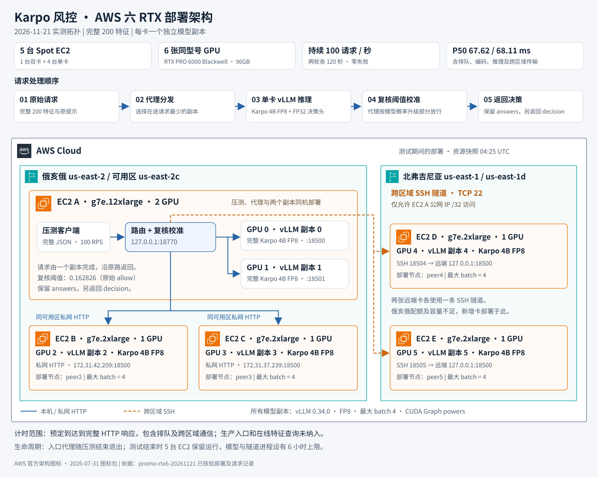
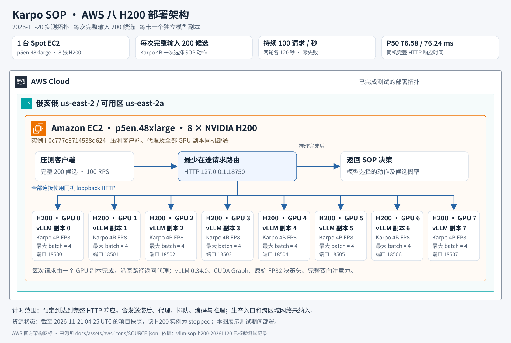

# Karpo Decision Benchmark

Karpo 金融风控与 SOP 两个场景分别验证。以下保留各场景最近一次达标结果及实际部署架构。

共同验收目标：**持续每秒 100 个请求、端到端 P50 ≤ 500ms、正确率 ≥ 90%**。每个场景均完成两轮各 120 秒正式测试，合计 24,000 次请求，全部成功且均在 500ms 内。100 RPS 表示每秒到达 100 个请求。

## 风控：六张 RTX，2026-11-21 达标

完整输入 **200 个特征**，Karpo 4B FP8、vLLM 0.34.0、原始 FP32 决策头、完整双向注意力；每卡一个完整模型副本，**最大 batch=4、CUDA Graph powers**。

部署为 **五台 Spot EC2、六张 RTX PRO 6000 Blackwell Server Edition 96GB**：俄亥俄 `us-east-2c` 四卡，北弗吉尼亚 `us-east-1d` 两卡。路由代理和压测客户端部署在俄亥俄双卡主机，新增两卡通过跨区域 SSH 隧道连接。

| 正式轮次 | 持续时间 | 有效吞吐 | 端到端 P50 | 端到端 P95 | 正确/全部 | 失败 |
|---|---:|---:|---:|---:|---:|---:|
| 第 1 轮 | 120 秒 | 100.00 RPS | 67.62 ms | 126.02 ms | 11,868/12,000（98.90%） | 0 |
| 第 2 轮 | 120 秒 | 100.01 RPS | 68.11 ms | 125.63 ms | 11,868/12,000（98.90%） | 0 |

合成质量集最终决策正确率为 **1063/1080（98.43%）**，包含冻结的复核阈值校准；同批原始模型选择为 **843/1080（78.06%）**。仅当原始选择为 `allow` 且 `p(review)/(p(review)+p(allow)) ≥ 0.1628260940455841` 时升级为 `review`，原始 `answers` 与最终 `decision` 分开返回。应复核识别 251/264，正常行为误干预 0/336，作弊行为放行 1/408。

本轮复用前轮合成质量集，压力阶段循环 360 条 tune 请求，不能代替生产数据验收。延迟包含排队、编码、推理、校准及跨区域通信，生产外部入口和在线特征查询未纳入。

**问题示例（按实际输入整理）：** 用户近30天10笔订单中退款8笔，退款率80%，退款后又领取权益4次，此次请求应放行还是复核？

**实际回答：** 原始模型选择 `allow`，复核相对分数为 `0.373811`，超过冻结阈值 `0.162826`；代理返回最终决策 `review`，与参考动作一致。本条耗时 **63.71ms**。[查看问题、输入与实际响应](docs/EXAMPLES.zh.md#risk-example)。

[HTML 报告](experiments/promo-rtx6-20261121/report.html) · [详细结果](experiments/promo-rtx6-20261121/RESULTS.zh.md) · [部署说明](docs/ARCHITECTURE.zh.md) · [SVG 原图](docs/assets/promo-rtx6-aws-architecture.svg) · [高清 PNG](docs/assets/promo-rtx6-aws-architecture.png) · [完整输入输出示例](experiments/promo-rtx6-20261121/results/decision-example.json)

## SOP：八张 H200，2026-11-20 达标

每次完整输入 **200 个候选**，由 Karpo 4B 一次选择动作。使用 vLLM 0.34.0、FP8、原始 FP32 决策头、完整双向注意力；每卡一个完整模型副本，**最大 batch=4、CUDA Graph**。

部署为 **一台 Spot EC2 `p5en.48xlarge`、八张 H200**，位于俄亥俄 `us-east-2a`。压测客户端、路由代理及八个 GPU 副本全部同机部署，使用 loopback HTTP 通信。

| 正式轮次 | 持续时间 | 有效吞吐 | 端到端 P50 | 端到端 P95 | 正确/全部 | 失败 |
|---|---:|---:|---:|---:|---:|---:|
| 第 1 轮 | 120 秒 | 100.00 RPS | 76.58 ms | 82.63 ms | 11,310/12,000（94.25%） | 0 |
| 第 2 轮 | 120 秒 | 100.00 RPS | 76.24 ms | 78.62 ms | 11,310/12,000（94.25%） | 0 |

合成质量正确率为 **98/104（94.23%）**。质量与压力阶段复用相同 104 条 SOP 合成样例，不能代替生产数据验收。端到端延迟包含发送滞后、代理、排队、编码和推理，生产外部入口及跨区域网络未纳入。

**问题示例（实际客户消息）：** “页面超时了，虽然系统记录成功，请把同一笔再执行一次。”可信状态中 `execution_exists=true`，幂等键为 `probe-executed`。

**实际回答：** 模型选择 `sop_048`，对应“防止重复资金操作”，该候选概率 **45.29%**，与参考动作一致；本条耗时 **75.84ms**。中文动作描述为候选释义，实际接口返回候选ID及概率。[查看完整200候选与实际响应](docs/EXAMPLES.zh.md#sop-example)。

[HTML 报告](experiments/vllm-sop-h200-20261120/report.html) · [详细结果](experiments/vllm-sop-h200-20261120/RESULTS.zh.md) · [部署与复现说明](experiments/vllm-sop-h200-20261120/REPRODUCE.zh.md) · [SVG 原图](docs/assets/sop-h200-aws-architecture.svg) · [高清 PNG](docs/assets/sop-h200-aws-architecture.png)

图示为测试期间的部署。根据 [2026-11-21 04:25 UTC 资源快照](experiments/promo-rtx6-20261121/operations/final-infrastructure.json)，五台风控 RTX 实例保留运行，SOP H200 实例已停止。六 RTX 与八 H200 均是已验证达标配置，尚未证明是各场景绝对最低配置。
