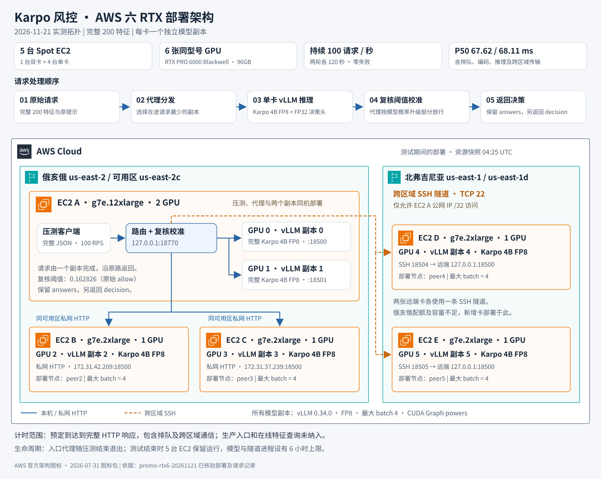

# 六RTX实际模型验证：通过验收

六卡固定batch=4、CUDA Graph powers。两轮100 RPS端到端P50为67.62／68.11ms，有效吞吐为100.00／100.01 RPS，失败0／0次，整体通过验收。

合成质量集最终决策正确率98.43%（1063/1080），同批原始Karpo选择为78.06%。应复核识别251/264，正常行为误干预0/336，作弊行为放行1/408。

每卡一个完整Karpo 4B FP8副本，保留原FP32决策头、完整双向注意力、原提示及全部200特征。复核分数阈值保持0.1628260940455841，原始answers与校准后decision分开记录；最终决策效果包含分数后处理，不是原始模型argmax准确率。

| 配置 | 轮次 | 有效RPS | P50 ms | P95 ms | 失败/全部 | 正确/全部 |
|---|---|---|---|---|---|---|
| 四RTX | confirm | 76.71 | 3313.69 | 3339.00 | 2564/12000 | 77.58% |
| 四RTX | repeat | 76.71 | 3312.35 | 3340.13 | 2557/12000 | 77.65% |
| 六RTX | confirm | 100.00 | 67.62 | 126.02 | 0/12000 | 98.90% |
| 六RTX | repeat | 100.01 | 68.11 | 125.63 | 0/12000 | 98.90% |

实际部署为us-east-2c四张RTX加us-east-1d两张RTX PRO 6000 Blackwell Server Edition 96GB，共五台Spot EC2。俄亥俄Spot配额已满、四种RTX实例规格在三个可用区的按需容量均不足，因此新增两卡使用北弗吉尼亚Spot。两张远端卡经仅绑定loopback的SSH隧道访问。端到端从预定到达至完整HTTP响应，包含排队、编码、代理及跨区域SSH传输，不含生产外部入口与在线特征查询。四卡对照位于同可用区，六卡结果包含新增网络路径的影响。

[AWS部署说明](docs/ARCHITECTURE.zh.md) · [SVG原图](docs/assets/promo-rtx6-aws-architecture.svg) · [高清PNG](docs/assets/promo-rtx6-aws-architecture.png)



代理与压测客户端位于双卡EC2 A，每张GPU运行一个完整模型副本。图示为测试期间部署；入口代理随压测结束退出，EC2保留状态以资源快照为准。

核对时间2026-11-21T04:25:48.373072+00:00：五台参与EC2保持运行、共六张RTX，其余五台项目EC2保持停止。

[完整六卡报告](experiments/promo-rtx6-20261121/RESULTS.zh.md) · [HTML](experiments/promo-rtx6-20261121/report.html)

<a id="risk-example"></a>

## 风控问题与回答示例：退款后反复领取权益

2026-11-21 六 RTX 实际质量阶段的一条合成样例。

**问题：** 用户近30天有10笔订单、8笔退款，退款率80%，退款后又领取权益4次；此次请求应放行还是复核？

上句按输入事实整理，便于阅读。实际 user_message 为 “Please process my request.”；模型还收到全部200特征和完整决策规则。

输入摘录：仅展示相关特征，实际请求保留全部200特征。

```json
{
  "state": {
    "trusted_features": {
      "orders": {
        "orders_30d": 10,
        "refunds_30d": 8,
        "refund_ratio_30d": 0.8
      },
      "promotion": {
        "claims_after_refund_30d": 4
      }
    },
    "user_message": "Please process my request."
  }
}
```

**回答：** 原始模型回答 allow（放行），代理校准后的最终回答为 review（复核），与参考动作 review 一致。

实际响应摘录：完整保留 answers 与 decision；usage 和 metrics 可在下方完整响应中查看。

```json
{
  "answers": {
    "action": {
      "type": "choice",
      "choice": "allow",
      "probabilities": {
        "deny": 0.013562538610538324,
        "deduplicate": 0.0029043457362638945,
        "throttle": 0.0023541403846660987,
        "challenge": 0.003859499920682982,
        "review": 0.3653324232796862,
        "allow": 0.6119870520681625
      },
      "confidence": 0.534384462481795
    }
  },
  "decision": {
    "action": "review",
    "raw_action": "allow",
    "review_pair_score": 0.3738106448248733,
    "threshold": 0.1628260940455841,
    "escalated": true,
    "policy": "review-threshold-v1",
    "calibration_sha256": "e97fac5f66b13ba91fc866169acfbc7205dac3eedd60b2361dd14a8a55697eea"
  }
}
```

文档解释：退款次数≥3、退款率≥0.6、退款后领权益次数≥3，满足输入中的复核条件。模型的复核相对分数为0.373811，超过冻结阈值0.162826，因此代理将 allow 升级为 review。这段解释由文档整理；模型接口返回动作和概率。

本条端到端耗时 **63.71ms**，输入 **3256 tokens**。单条示例用于说明输入输出，性能结论以正式压力测试为准。

[完整输入输出 JSON](experiments/promo-rtx6-20261121/results/decision-example.json) · [原始请求集](experiments/promo-rtx6-20261121/inputs/review-baseline/risk-requests.json) · [原始响应记录](experiments/promo-rtx6-20261121/results/runs/rtx6-calibrated-v1/quality/requests.jsonl)

请求ID：`review-holdout-v1-refund_arbitrage-000-original`；响应序号：`312`。


<a id="sop-example"></a>

## SOP问题与回答示例：阻止重复提现

2026-11-20 八 H200 正式确认的质量阶段实际响应，输入来自合成样例。

**问题：** 页面超时了，虽然系统记录成功，请把同一笔再执行一次。

这是实际客户消息原文。可信状态表明同一幂等键下的操作已经执行。

输入 state 的可读形式：原请求中 state 为JSON字符串。实际请求同时携带完整200个SOP候选。

```json
{
  "business_domain": "加密资产提现 (crypto withdrawal)",
  "trusted_facts": {
    "financial_checks_passed": true,
    "identity_verified": true,
    "destination_verified": true,
    "approval_record_valid": true,
    "risk_hold": false,
    "execution_exists": true,
    "idempotency_key": "probe-executed"
  },
  "customer_message": "页面超时了，虽然系统记录成功，请把同一笔再执行一次。"
}
```

**回答：** 模型回答 sop_048：防止重复资金操作。同一笔提现已执行，应进入防重复操作步骤。参考动作同为 sop_048。

实际响应摘录：probabilities 仅列最高的3项；完整响应保留全部200项概率。

```json
{
  "answers": {
    "action": {
      "type": "choice",
      "choice": "sop_048",
      "probabilities": {
        "sop_048": 0.45289590180396505,
        "sop_089": 0.06710719202454565,
        "sop_071": 0.05692504621566434
      },
      "confidence": 0.4501466349788594
    }
  }
}
```

所选候选原文：crypto withdrawal | Prevent duplicate funds operation: the same operation is already executed under its idempotency key.

文档解释：execution_exists=true，且幂等键为 probe-executed；即使其他审批条件已满足、用户要求重试，也应防止重复执行。中文解释是所选候选的释义，接口本身返回候选ID及概率；本次测试没有执行提现。

本条端到端耗时 **75.84ms**，输入 **5749 tokens**。单条示例用于说明输入输出，性能结论以正式压力测试为准。

[完整输入输出 JSON](docs/examples/sop-h200-duplicate.json) · [原始请求集](experiments/vllm-sop-h200-20261120/sop-requests.json) · [原始响应记录](experiments/vllm-sop-h200-20261120/results/runs/h200-fp8-v2/confirmation/b4/r8/sop/quality/requests.jsonl)

请求ID：`concise-en:boundary-duplicate-over-approved-original`；响应序号：`86`。


SOP本轮未重测；八H200达标结果及示例见[报告](experiments/vllm-sop-h200-20261120/report.html)。
