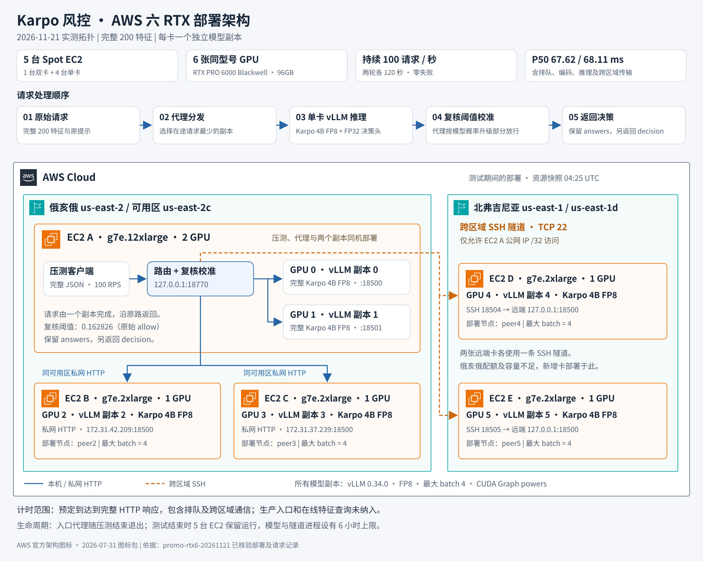

# 六 RTX 风控验证：AWS 部署架构

公网演示的 S3 + CloudFront OAC、内部 ALB、API 与自动 GPU 启停架构见[实时演示部署说明](DEMO.zh.md)。下图保留基准测试时的实际请求路径。

两场景的部署要点、相对原生Karpo服务的优化，以及同卡、多卡和公网链路的实测收益见[部署方案、原生对照与优化收益](DEPLOYMENT-OPTIMIZATION.zh.md)。

本图对应 2026-11-21 已完成的六卡实际模型测试：**五台 Spot EC2、六张 RTX PRO 6000 Blackwell Server Edition 96GB，每卡一个完整 Karpo 4B FP8 副本**。图中资源及进程的位置描述测试期间的部署，资源状态依据当日 04:25:48 UTC 快照。

[查看 SVG 原图](assets/promo-rtx6-aws-architecture.svg) · [下载高清 PNG](assets/promo-rtx6-aws-architecture.png) · [六卡 HTML 报告](../experiments/promo-rtx6-20261121/report.html)

请求如何转化为决策，见[问题、输入与实际回答示例](EXAMPLES.zh.md#risk-example)，其中保留完整200特征、原始模型输出和复核校准结果。



## 实例与副本

| 图中实例 | EC2 ID | 规格 | 可用区 | GPU / 副本 | 承载进程 |
|---|---|---|---|---|---|
| A | `i-05b24e3b4a7ee864d` | g7e.12xlarge | us-east-2c | 0、1 | 压测客户端、路由与校准代理、两个 vLLM 副本、远端 SSH 隧道 |
| B | `i-02c1caf7d7ce17c76` | g7e.2xlarge | us-east-2c | 2 | 一个 vLLM 副本 |
| C | `i-05cfc7d4fa898ee33` | g7e.2xlarge | us-east-2c | 3 | 一个 vLLM 副本 |
| D | `i-09e55f0a86313912d` | g7e.2xlarge | us-east-1d | 4 | 一个 vLLM 副本 |
| E | `i-0b7835341b1266d7a` | g7e.2xlarge | us-east-1d | 5 | 一个 vLLM 副本 |

GPU 0～5 是本次部署的全局副本编号；A 的本地 GPU 编号为 0、1，其他四台的本地 GPU 编号均为 0。六个副本之间独立处理请求，每次推理使用一张卡，`tensor_parallel_size=1`。

俄亥俄原四卡已占满该区域 G/VT Spot vCPU 配额，三个可用区尝试四种 RTX 实例规格也未取得按需容量，因此新增两卡部署到北弗吉尼亚。两个区域使用相同型号 GPU。

## 请求路径

1. EC2 A 上的压测客户端按固定 **100 请求/秒**调用 `POST http://127.0.0.1:18770/v1/systemone`，传入完整 200 特征和原始提示。
2. 自建异步 HTTP 代理选择**当前在途请求最少**的副本；在途数量相同时轮换选择。代理将原始请求 JSON 转发至该副本。
3. 副本执行原始输入编码和 vLLM 推理。六个副本均使用 Karpo 4B FP8、原始 FP32 决策头、完整双向注意力，`max_num_seqs=4`、CUDA Graph `powers`。Batch 4 是每卡最大活跃序列数，无需凑满四条才运行。
4. 模型响应沿原连接返回代理。仅当原始动作是 `allow` 且 `p(review) / (p(review) + p(allow)) >= 0.1628260940455841` 时，将最终动作升级为 `review`。原始概率与选择保留在 `answers`，最终动作及校准记录另放在 `decision`。
5. 代理向客户端返回完整 HTTP 响应。该响应是模型决策及校准结果；人工复核或业务执行不属于本轮压测链路。

该代理是 EC2 A 上的应用进程。当前验证链路未部署 ALB、API Gateway 或独立在线特征服务。

## 网络连接

| 目标副本 | 从 EC2 A 访问的地址 | 网络路径 |
|---|---|---|
| 0 | `127.0.0.1:18500` | 同机 HTTP |
| 1 | `127.0.0.1:18501` | 同机 HTTP |
| 2 | `172.31.42.209:18500` | us-east-2c 私网 HTTP |
| 3 | `172.31.37.239:18500` | us-east-2c 私网 HTTP |
| 4 | `127.0.0.1:18504` | SSH 隧道转发到 EC2 D 的 `127.0.0.1:18500` |
| 5 | `127.0.0.1:18505` | SSH 隧道转发到 EC2 E 的 `127.0.0.1:18500` |

两条跨区域 SSH 隧道使用 TCP 22。新增节点的安全组仅允许 EC2 A 的公网地址 `3.14.73.171/32` 连接；远端模型服务绑定 loopback。图中蓝色实线表示本机或私网 HTTP，橙色虚线表示跨区域 SSH。

## 对应实测结果

| 正式轮次 | 时长 / 请求数 | 稳态有效吞吐 | 端到端 P50 | 端到端 P95 | 失败 |
|---|---|---|---|---|---|
| confirm | 120 秒 / 12,000 | 100.00 RPS | 67.62 ms | 126.02 ms | 0 |
| repeat | 120 秒 / 12,000 | 100.01 RPS | 68.11 ms | 125.63 ms | 0 |

端到端计时从请求预定到达开始，到收到完整 HTTP 响应结束，包含发送滞后、排队、输入编码、代理、推理、复核校准和跨区域 SSH 通信。生产外部入口和在线特征查询未纳入。100 RPS 表示每秒到达 100 请求。

同一合成质量集上，校准后的最终决策正确率为 **98.43%（1063/1080）**，原始模型选择正确率为 **78.06%（843/1080）**。质量集沿用前轮合成样本，结论属于硬件扩容复测。

入口代理由压测程序管理，随本轮测试结束退出。测试结束时五台参与 EC2 按要求保留运行；模型和 SSH 隧道进程设有六小时上限。本图描述已验证的部署关系，不能作为这些进程此刻仍然运行的状态证明。

## 图与文档的维护

AWS 图标来源见 [图标说明](assets/aws-icons/README.md)。矢量图由 [绘图脚本](../scripts/promo_rtx6_architecture.py)依据冻结的资源快照和核验结果生成；PNG 是同一 SVG 的两倍分辨率导出。

```bash
python scripts/promo_rtx6_architecture.py
# 安装可选绘图依赖后，同时生成 3360 × 2680 PNG：
python -m pip install cairosvg
python scripts/promo_rtx6_architecture.py --png
python scripts/report.py
```

本次增加架构图并更新报告展示，未重跑 GPU 测试或调整部署。原始请求、模型配置、核验结果、`manifest-v1.json`、`EVIDENCE.json` 及 S3 `complete-v1.tar.gz` 保留原版本；`EVIDENCE.json` 中的文档哈希对应封存时的文档，当前文档修订由 Git 记录。

依据：[资源快照](../experiments/promo-rtx6-20261121/operations/final-infrastructure.json)、[逐条核验结果](../experiments/promo-rtx6-20261121/results/verification.json)、[部署控制器](../scripts/promo_rtx6_controller.py)、[路由实现](../scripts/vllm_rps_proxy.py)、[校准代理](../scripts/promo_opt_calibrated_proxy.py)、[原始归档回执](../experiments/promo-rtx6-20261121/operations/archive-receipt.json)。
