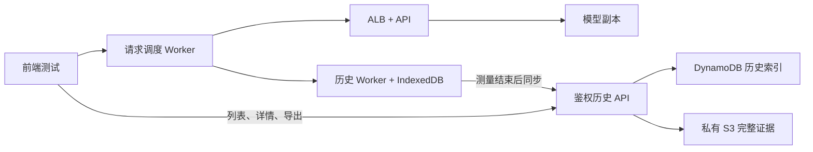
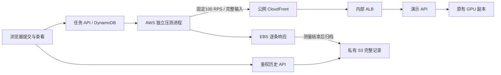

# Karpo 实时前端演示

演示地址：**https://deq0avneozfys.cloudfront.net**

页面直接调用 Karpo 4B GPU 模型，包含薅羊毛风控与 SOP 两个独立场景。部署入口为 **S3 + CloudFront OAC**，API 通过 **CloudFront VPC origin → 内部 ALB → EC2 服务**提供。用户点击启动后先确认全部 GPU 模型就绪，再开放推理按钮。

## 使用方法

1. 打开上述 HTTPS 地址，输入用户名和密码。当前演示用户名为 `demo`，密码保存在工作区 `.state/demo-login.json`，文件权限为 `0600`，未提交 Git；服务端 Secrets Manager 仅保存用户名及加盐密码哈希。登录本身不会启动 GPU。
2. 选择「薅羊毛风控」或「SOP 决策」，点击「启动演示」。风控会启动已有的五台 EC2、六张 RTX；SOP 会启动已有的一台 EC2、八张 H200。可以只演示其中一个场景。
3. 等待页面显示 **6/6 或 8/8 副本就绪**。检查包括 EC2 运行状态、SSM 启动服务、模型加载与 CUDA Graph 准备。EC2 处于 running 不代表模型已经可调用；冷启动通常需要数分钟，Spot 容量不足时页面会显示错误。
4. 选择示例，可修改可信事实和客户消息，点击「运行实时决策」。风控保留完整 200 特征，SOP 保留完整 200 候选。单次决策显示后端服务端到端延迟，页面可展开完整请求和实际响应。
5. 在页面下方「固定 RPS · 多场景测试」选择历史问题集，默认全选；可按场景、关键词和候选顺序筛选。测试统一在 AWS 云端执行，默认 **100 RPS、120 秒、12,000 个请求**。浏览器只负责提交和显示，刷新、断网不会中断任务；重新打开页面恢复查看。测试完成后可查看性能、两种正确率、逐条完整输入输出并导出 JSON。
6. 点击右上角「结束演示」。最后一个演示会话退出后进入 **10 分钟倒计时**，由 AWS 服务自动停止本次使用的 GPU EC2。

关闭页面时会尝试发送结束通知；即使通知未送达，连续 10 分钟无操作也会触发回收。仅查看状态的自动轮询不会延长 GPU 使用时间。GPU 停止后页面与 API 继续在线，下次演示重新点击启动即可。

## 实际部署


[SVG 原图](assets/demo-aws-architecture.svg) · [高清 PNG](assets/demo-aws-architecture.png) · [资源清单](../operations/demo-20261121/resources.json)

| 层级 | 部署 |
|---|---|
| 前端 | 私有 S3 bucket `karpo-demo-20261121-632930644527`，站点文件位于 `site/`；Block Public Access 开启，OAC 限定该 CloudFront 分发读取 |
| 公网入口 | `deq0avneozfys.cloudfront.net`，HTTPS；默认路径返回静态页面，`/api/*` 禁用缓存并转发认证 Cookie |
| ALB | `us-east-2` 内部 ALB，跨两个子网；仅允许 CloudFront VPC origin 安全组访问 |
| API 服务 | `us-east-2` 按需 `t4g.small`，`i-04aa43d75617e765b`，FastAPI + systemd；CPU 常驻，提供登录、状态、启停和模型请求转发 |
| 云端压测 | 复用同一 CPU EC2，独立 `karpo-demo-cloud-worker` 进程，按固定速率调用公网 CloudFront；一次只运行一轮，最多100 RPS×120秒，无需新增 GPU 或 EC2 |
| 历史存储 | 独立 DynamoDB 历史表保存任务、指标与索引；私有 S3 `history/*` 保存完整输入和逐条响应，OAC不能读取此路径 |
| 风控 | 沿用五台 Spot EC2、六张 RTX PRO 6000 Blackwell；`us-east-2` 四卡，`us-east-1` 两卡 |
| SOP | 沿用 `us-east-2` 的 `i-0c777e3714538d624`，Spot `p5en.48xlarge`，八张 H200 |
| GPU 连接 | API → GPU TLS 网关 `19443`；俄亥俄走私网，北弗吉尼亚仅允许 API 固定 EIP 访问；证书信任与节点令牌校验，模型进程仅监听 loopback |
| 启停状态 | DynamoDB 保存会话租约、截止时间、推理保护期限和状态版本 |
| 自动停机 | EventBridge 每分钟触发 Lambda；校验截止时间并对固定白名单调用 `StopInstances` |

GPU 实例白名单与副本编号见 [demo/config.json](../demo/config.json)。CPU API、ALB 等持续运行资源不属于停机白名单。

这些 GPU 已关联专用演示 IAM 实例配置文件，原配置保存在操作目录的 `initial-us-east-*.json` 快照。白名单内实例由演示回收器统一管理：在 EC2 控制台直接启动且没有演示租约，也会被自动回收。进行独立的长时间基准测试前，需先暂停 EventBridge 规则 `karpo-demo-20261121-stop`，测试结束后恢复。

### 10 分钟自动停止的定义

- 最后一个演示者点击结束时，服务端保存 `stop_after = 当前时间 + 600 秒`。
- 未点击结束时，最后一次操作或推理请求维持约 600 秒会话。推理按会话每 5 秒合并续期，保存 605 秒期限以覆盖缓存窗口，空闲回收最多多约 5 秒；页面仅在检测到新操作时续期，状态轮询不续期。
- 不同登录会话可以同时演示；一个演示者结束不会中断其他仍活跃的会话。结束按钮释放该登录会话已开启的两个场景。
- 云端压测拥有独立的 GPU 租约，浏览器关闭只释放浏览器会话。云端推理维持续期，任务保存完成后释放自己的租约；不会释放其他演示者的租约，也不会绕过10分钟回收规则。
- EventBridge 每分钟执行一次，因此截止时间到达后通常 **0～60 秒内发出停机请求**；EC2 从 stopping 到 stopped 还需要一定时间。页面显示实例停止确认，不能将倒计时归零当作已经停机。
- 初次加载模型设有 30 分钟启动保护期限，超时会回收；主动结束可以提前进入 10 分钟回收流程。正在进行的推理受最长 150 秒请求租约保护。
- DynamoDB 条件写入协调启动与停止。停止期间不接受新启动；停止完成后可再次演示。回收器也会处理异步启动晚到造成的未租用运行实例。
- 停机逻辑运行于独立 Lambda，不依赖浏览器保持打开或 API 进程持续运行；不删除实例、磁盘或模型。

## 输入和回答

上方六个快捷示例来自既有测试输入，每次都通过 GPU 执行。下方问题集包含全部1,904条历史请求及参考答案；参考答案仅供压测程序事后评分，不发给模型，也不用于返回预置决策。

| 场景 | 问题 / 可信状态 | 实际动作 |
|---|---|---|
| 风控 | 近 30 天十笔订单退款八笔，退款后再次领取权益四次 | 原始 `allow` → 最终 `review` |
| 风控 | 正常账户、设备与请求 | `allow` |
| 风控 | 请求签名异常 | `deny` |
| SOP | “页面超时了，虽然系统记录成功，请把同一笔再执行一次。”；`execution_exists=true` | `sop_048`，防止重复资金操作 |
| SOP | 审批通过，但存在合规冻结 | `sop_017` |
| SOP | 准备执行资金操作，但新目的地址未验证 | `sop_157` |

完整输入见 [demo/catalog.json](../demo/catalog.json)，原始基准问题与回答详见 [EXAMPLES.zh.md](EXAMPLES.zh.md)。页面允许编辑状态，候选与规则固定；风控删除特征或修改规则会返回输入校验错误。

薅羊毛风控沿用冻结复核阈值 `0.1628260940455841`：仅当原始选择为 `allow` 且 `p(review)/(p(review)+p(allow))` 达到阈值时升级为 `review`。响应中的 `answers` 保留模型原始结果，`decision` 展示校准过程。旧版服务资源风控使用其原始200特征结构和规则，不应用薅羊毛复核校准；SOP 返回原始模型候选选择。

两个场景沿用 FP8、原始 FP32 决策头、完整双向注意力及每卡独立 vLLM 副本，最大 batch 固定为 4。单次决策显示响应中 `demo.service_ms` 的**后端服务端到端延迟**：API推理处理开始，经服务端排队、GPU网络往返和模型推理，直到复核及最终决策就绪。该计时从鉴权与输入校验完成后开始，不包含浏览器网络、CloudFront/ALB入口传输、最终响应序列化及下载；缺少服务端计时则显示「—」。

新保存的单次历史记录标记为「后端计时」，其 `elapsed_ms`、P50采用同一服务端字段；浏览器往返仅保存在 `browser_elapsed_ms`，整次HTTP等待时长保存在 `duration_ms`。此前单次历史保留原值并标记「浏览器计时」。多场景压力测试统一显示**AWS压测进程收到完整响应的时间**，包含该链路排队；旧浏览器压力测试仅保留历史记录及原计时口径。每场景最多接收 100 个同时在途演示请求；既有 100 RPS 达标结果属于 [README 中的基准链路](../README.md)，公网演示入口另外记录实测结果。

## 固定 RPS 多场景测试

默认每秒到达 **100 个请求，持续120秒，共12,000次**；每10ms安排一次请求，发送不等待前一条响应。可设置1–100 RPS及1–120秒。所有多场景测试在 AWS 独立进程中调度，浏览器一次提交所选原始问题编号，AWS读取并逐条发送完整原始正文。页面只轮询进度，用户本地连接或上传带宽不承担100 RPS负载。页面已移除浏览器执行模式及其客户端加载。发送速率与同时在途数量分别记录。

| 问题集 | 请求条目 | 场景覆盖 | 原正式测试用途 |
|---|---:|---|---|
| 薅羊毛正式压力集 | 360 | 45类行为、180组状态，每组候选原序/逆序 | 六RTX正式100 RPS循环输入 |
| 薅羊毛质量集 | 1,080 | 同45类行为、540组状态，每组两种顺序 | 最终质量1063/1080评估 |
| 服务资源风控旧版对照 | 360 | 拒绝、去重、限流、验证、复核、放行六类，180组状态×两种顺序 | 原始200特征风控对照 |
| SOP完整集 | 104 | 10个业务域、52组状态×两种顺序，含12组边界/冲突状态 | 八H200质量与正式压力输入 |

[完整业务场景与边界清单](DEMO-SCENARIOS.zh.md)。所有输入直接读取已测试文件，保留完整200特征/候选、候选顺序及SOP状态字符串空格。历史问题额外携带原始`request_json`，发送时直接使用该字符串，避免JavaScript将`0.0`重写为`0`改变模型输入token；导出中的`request_json`是实际发送正文。验证还逐条对比模型返回的token哈希与原基准记录。相同业务输入的精度、提示词或batch实验不重复列为新业务场景。

- 默认选择所选问题集全部条目，按顺序循环。可以筛选场景、关键词和原序/逆序；点击「仅选筛选结果」后按该子集测试。「全部选择」选中整套问题集，「清空选择」取消全部。
- 上方修改后的输入可另存为自定义问题，每场景最多20条自定义快照。自定义问题没有自动参考答案；原问题的参考动作仅用于测试后评分，永远不放入模型请求。切换问题集会重新载入列表，自定义条目需先运行并导出以便保存。
- 开始后冻结本轮配置与输入。「停止发送」停止后续到达并等待已发送请求返回；未发送数单独记录。结束演示按钮在请求排空后可用。
- 列表每页50题，结果表显示最近100次；导出包含全部选中输入、参考动作、逐次模型回答/错误、计划与实际发送时间和指标。完整记录自动保存在历史；云端测试刷新后恢复同一任务，已完成任务从历史查看。
- GPU未就绪、未登录或未开启演示时不能测试。请求持续维持租约，完成测试后仍需点击「结束演示」，随后按正常10分钟规则回收。

| 页面指标 | 统计口径 |
|---|---|
| 目标 RPS | 固定计划到达速率，100表示每秒安排100次请求 |
| 稳态有效 RPS | 最后75%发送窗口内完成的有效请求数÷窗口秒数；120秒测试统计第30至120秒，与原压测一致 |
| 全程成功 RPS | 成功数÷从首条计划到达到发送窗口结束且全部请求排空的整轮秒数，包含收尾 |
| P50 / P95 / P99 | 成功请求从**计划到达时间**至完整响应解析完成；包括发送滞后、连接等待、网络、服务端排队及模型处理；nearest-rank分位数。计时起止点均在AWS压测进程 |
| HTTP P50 | 从实际发起HTTP请求至完整响应解析完成，供区分发送滞后 |
| API / 模型阶段 P50 | 服务端报告的API服务时间、模型等待与计算时间，仅用于定位，不代替端到端延迟 |
| 最大发送滞后 | 实际发起时间减计划到达时间的最大值 |
| 峰值在途 | 已发起而未收到完整响应的最大请求数，独立于RPS与GPU batch |
| 成功率 | 有效模型响应数÷已完成尝试数，含HTTP/网络/格式错误；不是决策正确率 |
| 全量有效正确率 | 最终决策与参考动作一致数÷已完成有标签尝试数；失败计入分母，自定义无标签输入不计 |
| 成功响应正确率 | 正确数÷成功返回且有参考答案的请求数；区分模型判断与请求失败，不能替代成功率及全量正确率 |
| 平均 / 最慢 / 进度 | 成功请求平均/最大延迟，完成、计划、在途、未发送与总耗时 |

正式性能判定要求100 RPS、120秒、计划请求全部完成且零失败、整体及末25% P50≤500ms、稳态有效RPS≥99、最大发送滞后≤100ms、稳态积压增长斜率≤0.1请求/秒。正确率≥90%单独查看。正式配置的两个场景各跑两轮；小规模或筛选子集的结果仅代表对应输入。

没有成功响应时延迟显示「—」。不自动重试，不剔除本轮慢请求或预热。HTTP等待上限65秒，云端压测客户端最多500条在途；达到上限的计划到达明确计为失败。后端每场景最多100条在途，超额返回429；每GPU最多16条，等待空位最多30秒，模型最大batch保持4。一次仅允许一个云端任务；其他演示者启动云端测试会得到明确冲突提示，避免叠加负载。

API将推理会话续期合并为约每5秒一次DynamoDB读写，请求完成后无需再写DynamoDB。持久化会话仍由CAS协调，结束/启动操作同步使缓存失效；150秒保护期限覆盖缓存窗口内已接收的推理。DynamoDB中的保护记录按会话保存，不再逐请求记录100个在途。API重启不会丢失回收截止时间。路由优先选择在途较少的GPU，同负载时按原基准轮转，避免总选靠前副本；控制线程复用AWS SDK客户端。云端统计在后台线程计算，并及时释放已完成请求任务，发送循环仅保留待完成任务。CPU API使用uvloop事件循环和httptools解析HTTP，云端压测也使用uvloop；模型转发和云端压测请求使用aiohttp连接池，设置完整请求超时且不重试POST。显式安装sniffio避免HTTP库反复探测缺失的可选依赖。API的Uvicorn keep-alive设为210秒，长于ALB的180秒空闲超时，避免ALB复用已被API关闭的连接。API到GPU的HTTP连接池将空闲复用期限设为2秒，早于网关默认5秒的关闭期限；上游连接异常记录类型、请求ID与副本编号，不记录凭据或输入，不自动重试。

公网实测经过CloudFront、ALB、CPU API和GPU TLS网关；与README原基准使用相同负载和输入，但链路更长。当前多场景云端测试不包含用户本地网络，不能据此承诺任意地区浏览器的500ms体验。

### 2026-11-21 云端固定RPS与积压修复

**风控已连续两轮通过：100 RPS × 120秒，两轮共24,000次请求，全部成功。** 沿用完整360条压力输入、六张RTX、FP8与最大batch=4；不新增EC2或GPU。压测与API仍运行于原有 `us-east-2` 的 `t4g.small`，使用独立进程。

下表测量的是 **AWS压测进程 → 公网CloudFront → ALB → API → GPU → 完整响应**，包含发送滞后、网络和所有排队，**不包含用户本地浏览器网络**。页面现已统一使用云端执行，旧浏览器测试结果保留在历史中。

| 正式轮次 | 成功 / 计划 | 稳态有效RPS | 云端端到端P50 | P95 | 正确 / 全部 | 峰值在途 |
|---|---:|---:|---:|---:|---:|---:|
| 第1轮 | 12,000/12,000 | 99.91 | 72.25 ms | 109.87 ms | 11,868/12,000（98.90%） | 23 |
| 第2轮 | 12,000/12,000 | 99.67 | 318.91 ms | 415.41 ms | 11,843/12,000（98.69%） | 52 |

两轮末25% P50为 **79.65/366.21ms**，最大发送滞后 **63.29/64.24ms**，积压斜率 **0.0215/0.0456请求/秒**，均通过原有检查。两轮延迟有波动，应同时保留两轮结果。正确率已包含失败请求；本次零失败，因此与成功响应正确率相同。

第一轮将浏览器上传限制为16,384字节/秒（约128kbps），并增加300ms网络延迟；第二轮浏览器断网15秒，期间云端继续完成 **1,623个请求**，恢复网络并刷新后继续显示同一任务。浏览器没有逐条发送模型推理请求。全部24,000个成功响应的模型输入token哈希与原六RTX基准一致，完整输入、回答和指标均已保存到历史。

此前用户浏览器测试安排10,000次请求，6,062次实际发出且全部返回200，3,938次在浏览器500条在途上限处被拒绝；浏览器P50为8,105ms，API服务阶段P50仅139.51ms。成功响应正确率98.85%，包含未发出失败后的全量正确率59.92%。证据定位到API之外的耗时，原记录未采集浏览器网络细分，不能进一步断言具体代理、带宽或协议原因。

本次将正式负载移到AWS，保留本地浏览器测试，并在CPU服务侧使用uvloop、httptools与aiohttp，复用AWS SDK客户端，按原基准轮转同负载副本，移出统计计算并释放已完成任务。此前云端方案的失败与发送抖动也保留：初次12,000次有29次429，之后三轮虽零失败、P50低于500ms，仍未通过发送滞后等附加检查；没有修改阈值或覆盖这些轮次。

此次只验收风控；SOP公共入口尚需用相同新版本单独验证，不能据此宣布SOP达标。[全部轮次、诊断及证据](../operations/demo-cloud-20261121/README.zh.md) · [指标与完整导出索引](../operations/demo-cloud-20261121/validation.json) · [当前页面](../operations/demo-cloud-20261121/risk-cloud.png)。

### 2026-11-21 公网固定RPS实测

**风控两轮通过；SOP仅第一轮通过，尚未稳定达标。** 客户端为`us-east-1`的`m8g.2xlarge`上Chromium浏览器，调用真实CloudFront入口。风控沿用六RTX，SOP沿用八H200，完整输入与原基准的模型token逐条核对。每轮100 RPS、120秒、12,000次计划请求，不自动重试。

| 场景 / 轮次 | 成功 / 计划 | 稳态有效 RPS | 端到端 P50 | P95 | 正确 / 全部有标签请求 | 性能判定 |
|---|---:|---:|---:|---:|---:|---|
| 风控 / 1 | 12,000/12,000 | 100.13 | 389.30 ms | 445.90 ms | 11,839/12,000（98.66%） | 通过 |
| 风控 / 2 | 12,000/12,000 | 99.94 | 364.30 ms | 439.80 ms | 11,842/12,000（98.68%） | 通过 |
| SOP / 1 | 12,000/12,000 | 100.03 | 107.00 ms | 208.90 ms | 11,310/12,000（94.25%） | 通过 |
| SOP / 2 | 9,398/12,000 | 72.73 | 928.00 ms | 3318.90 ms | 8,866/12,000（73.88%） | 未通过 |

SOP第二轮出现2,602次429限流；成功响应中的动作正确率为8866/9398（94.34%），但将失败计入全部计划请求后为73.88%。分段检查显示，第二轮开始约20秒后排队增多：模型排队与计算中位数约64–71ms，API请求阶段约925–1024ms。问题仍需在演示转发链路定位，不能用单轮通过或GPU计算耗时替代端到端稳定性验收。

SOP首次启动后的400次100 RPS短测也有21次429，已保留；随后20 RPS×20秒预热400次全部成功，再进行上述两轮正式测试。预热数据单独保存，不混入正式统计。预热并未解决持续负载下的全部问题；新验证脚本默认先以20 RPS运行20秒，页面可手动配置同样步骤。

完整质量集额外执行1,100次，覆盖全部1,080题，首次覆盖正确1063/1080（98.43%）；旧版资源风控执行400次，覆盖全部360题，首次覆盖正确347/360（96.39%）。两组均无HTTP失败，这些短测用于场景覆盖，未作为120秒性能验收。所有原始输入、候选顺序及浮点格式保留；正式轮次的45,398个成功响应token哈希与原基准一致。

验证还覆盖了筛选与原序/逆序选择、手机无横向溢出、完整输入输出与导出指标复算。提前停止轮次完成19次、未发送11,981次；无效自定义SOP输入两次均返回422，失败完整计入统计。32项Python检查与6项固定RPS/原始序列化检查通过。

本次修复了逐请求DynamoDB串行写入、浏览器浮点格式重写，以及API与ALB连接空闲期限不匹配。各阶段失败证据保留：[浮点格式排查](../operations/demo-rps-20261121-float-diagnostic/README.md)、[API到GPU连接调整前](../operations/demo-rps-20261121-pre-keepalive/README.md)、[ALB连接排查](../operations/demo-rps-20261121-alb-diagnostic/README.md)。不以重新运行覆盖失败记录。

[全部轮次、指标与压缩原始导出索引](../operations/demo-rps-20261121/validation.json) · [部署版本](../operations/demo-rps-20261121/deployment.json) · [风控页面](../operations/demo-rps-20261121/risk-rps.png) · [SOP页面](../operations/demo-rps-20261121/sop-rps.png)。GPU测试会话已分别结束，按原600秒截止时间自动回收，未手动停止其他会话。

### 旧版闭环验证记录（已由固定RPS界面替代）

### 2026-11-21 公网多问题验证

11:01–11:03 UTC，通过实际CloudFront页面，使用六个快捷示例的完整字段分别验证两个场景。旧版浏览器会将部分浮点数如`0.0`重写成`0`，因此风控模型token与基准不完全相同；当前版本已通过原始`request_json`修复并增加token核对。以下为保留的有限请求数闭环记录，未剔除失败或预热。

| 场景 | 并发 | 问题数 | 成功 / 请求 | 成功 RPS | 端到端 P50 | 端到端 P95 |
|---|---:|---:|---:|---:|---:|---:|
| 风控 | 1 | 3 | 3/3 | 7.20 | 139.60 ms | 166.40 ms |
| 风控，含编辑问题 | 4 | 4 | 12/12 | 24.90 | 134.00 ms | 207.50 ms |
| 风控 | 100 | 3 | 300/300 | 37.55 | 2,531.70 ms | 2,837.30 ms |
| SOP | 1 | 3 | 3/3 | 7.04 | 126.00 ms | 179.50 ms |
| SOP，含编辑问题 | 4 | 4 | 12/12 | 25.99 | 135.60 ms | 187.60 ms |
| SOP | 100 | 3 | 300/300 | 43.23 | 2,234.90 ms | 2,366.00 ms |

**100 并发功能已通过验证；公网演示链路的这两轮 100 并发测试未达到 P50 ≤ 500ms 或持续 100 RPS。** 两个场景的 100 并发轮次均达到浏览器峰值在途 100，原始三道示例各循环 100 次；共 600 个动作与预期一致。这是预置示例的功能检查，不是新的模型准确率评估。

验证还包括：将编辑后的输入加入第四道问题并真实执行；逐个核对浏览器发送的输入与导出快照，包括 SOP 字符串空格；独立复算导出的 RPS 和分位数；停止发送后四个在途请求全部完成、996 个请求未发送；无效 SOP 输入返回两次 422，成功率显示 0%、延迟显示「—」，未重试。桌面及 390 像素手机页面无脚本异常和横向溢出。12 项生命周期、2 项 GPU 路由、6 项前端调度与指标检查通过。

[完整验证记录](../operations/demo-performance-20261121/validation.json) · [风控100并发原始导出](../operations/demo-performance-20261121/risk-c100.json) · [SOP100并发原始导出](../operations/demo-performance-20261121/sop-c100.json) · [风控性能面板](../operations/demo-performance-20261121/risk-performance.png) · [SOP性能面板](../operations/demo-performance-20261121/sop-performance.png)。

测试结束已释放本测试登录会话的两个场景租约；SOP 进入 600 秒回收倒计时，风控当时仍有其他演示者会话，继续保留至其结束或空闲超时。未手动停止其他演示者使用的 GPU。

## 公网验证记录

2026-11-21 10:16 UTC，经实际 CloudFront 域名登录，在 Chromium 中点击页面运行六个示例，**6/6 动作符合预期**。逐项核对发送的 `state` 和 `questions` 与原始示例一致，包括 SOP 状态字符串的空格。

| 实际页面示例 | 浏览器完整响应往返 | 输入 tokens |
|---|---:|---:|
| 风控：退款后重复领权益 | 128 ms | 3,172 |
| 风控：正常用户请求 | 108 ms | 3,160 |
| 风控：请求签名异常 | 110 ms | 3,155 |
| SOP：重复提现请求 | 142 ms | 5,749 |
| SOP：审批通过但存在冻结 | 133 ms | 5,729 |
| SOP：新提现地址未验证 | 123 ms | 5,733 |

这是六次浏览器功能验证，各值均为单次页面读数，不能据此推算 P50 或 100 RPS 性能。完整请求和响应见 [browser-validation.json](../operations/demo-20261121/browser-validation.json)，页面截图见[风控](../operations/demo-20261121/frontend-risk.png)、[SOP](../operations/demo-20261121/frontend-sop.png)与[手机版](../operations/demo-20261121/frontend-mobile.png)。

实际验证还包括：

- CloudFront 页面 HTTP 200，匿名 S3 访问 403，未登录 API 401；确认 OAC、内部 ALB 安全组和仅六台 GPU 的停机 IAM 白名单，见[访问与权限验证](../operations/demo-20261121/security-validation.json)。
- 未开启会话和结束会话后推理返回 409；修改候选规则或提交无效 JSON 返回 422；跨站来源返回 403。API 响应 `no-store`，浏览器无脚本异常，390 像素手机视口无横向溢出。
- 九项生命周期检查通过，覆盖 600 秒截止时间、多会话、重复结束、启动与停止竞争、在途请求和迟到的启动。
- 六台 GPU 的服务均已设为开机启动，模型和 Python 环境均位于持久化 EBS 根卷；已核对实际安装的节点代码哈希，见[重启持久化检查](../operations/demo-20261121/persistence-validation.json)。

2026-11-21 10:49 UTC，用户名密码登录已部署并完成独立验证：9 项认证单元测试通过；实际公网浏览器确认正确账号可登录、刷新保持会话、错误密码停留在登录页，篡改 Cookie 返回 401。10 个受保护的 API 路径在未登录时均返回 401；未知账号、原访问码请求及无效凭据均被拒绝，伪造 `X-Forwarded-For` 不能绕过登录限流。桌面及 390 像素手机页面无脚本异常或横向溢出。

本次登录验证未申请 GPU 租约，六台 GPU EC2 在变更前后均为 `stopped`，ALB 后端健康。[认证验证记录](../operations/demo-auth-20261121/validation.json) · [部署与 GPU 状态](../operations/demo-auth-20261121/deployment.json) · [桌面登录页](../operations/demo-auth-20261121/login-desktop.png) · [手机登录页](../operations/demo-auth-20261121/login-mobile.png)。

### 实际自动停机

本轮通过页面结束演示，随后仅观察 AWS 状态，未手动调用停机、缩短倒计时或强制关机。六台 GPU EC2 最终全部停止，CPU API 继续运行。

| 事件 | 2026-11-21 UTC |
|---|---|
| 页面结束两个场景 | 10:16:14 |
| 服务端 600 秒截止时间 | 10:26:14 |
| Lambda 停止俄亥俄三台 RTX | 10:26:59 |
| Lambda 停止北弗吉尼亚两台 RTX | 10:27:00 |
| Lambda 停止 H200 | 10:27:01 |
| 首次观察到五台 RTX 全部 `stopped` | 10:34:06 |
| 首次观察到 H200 `stopped` | 10:37:43 |
| 两场景控制状态均确认 `stopped` | 10:38:04 |

**10 分钟是发起自动停机的截止时间，之后还有每分钟调度和 AWS 异步停止过程。** 本轮停机请求比截止时间晚 45～47 秒，符合检查周期；H200 的最终状态转换明显慢于 RTX。页面会持续显示 stopping，直到 AWS 确认停止。

[CloudTrail 自动停机调用](../operations/demo-20261121/automatic-stop-cloudtrail.json)记录了专用 Lambda 角色对六台实例的三次 `StopInstances` 请求，均未启用 force 或跳过操作系统关机。[完整停机观察](../operations/demo-20261121/shutdown-validation.json)保存原始截止时间和状态变化；[停机后的页面验证](../operations/demo-20261121/post-shutdown-frontend.json)确认仍可登录，启动按钮可用，推理按钮禁用，未再次启动 GPU。

## 部署与维护

实现位于 [demo/](../demo/)，资源操作记录位于 [operations/demo-20261121/](../operations/demo-20261121/)。脚本针对当前已有 GPU 实例、模型目录和 AWS 账号，依赖 AWS 凭据、boto3，以及已安装的 `/opt/karpo/venv-vllm034` 与 `/opt/karpo/models/karpo-4b`。

```bash
# 首次创建 AWS 控制资源；检查点保存在 resources.json，重复运行复用已有资源
python demo/infrastructure/provision.py
python demo/infrastructure/history_setup.py

# VPC origin Deployed 后创建分发、OAC、bucket policy 并上传前端
python demo/infrastructure/edge.py

# 将完整原始输入及模型服务代码打包、安装
python demo/infrastructure/package.py
python demo/infrastructure/install.py backend
python demo/infrastructure/install.py worker
python demo/infrastructure/install.py nodes
python demo/infrastructure/install.py status
```

安装 GPU 服务需要目标实例已启动且 SSM 在线。初次安装可分别用 `install.py start-risk`、`install.py start-sop` 先写入回收期限再启动；然后执行 `install.py nodes`，通过页面重新开启演示确认模型就绪。正常演示由页面按场景启动，无需再次安装。若模型节点尚未具备 SSM 权限，需要先给其关联演示节点实例配置文件并确认 SSM Agent 在线。

更新前端后运行 `edge.py` 上传并使 CloudFront 缓存失效；更新后端后运行 `package.py` 和 `install.py backend`。云端压测进程单独用 `install.py worker` 安装或重启，应等当前任务完成后执行；中途进程重启会保留已落盘记录并标为中断，不自动重发请求。新建 CloudFront 域名后须安装后端，使其读取正确的同源校验域名。节点代码更新需重新安装并在无演示请求时重启 `karpo-demo-node`。更新回收器代码运行 `install.py watchdog`；修改配置时还需由 `provision.py` 更新 Lambda 环境配置与 IAM 白名单。

## 历史测试记录

页面底部「历史测试记录」保存所有后续单次决策和固定 RPS 测试。可按风控/SOP、来源、实验名、问题集、日期或编号筛选；列表显示测试状态、成功/完成数量、吞吐、P50、参考答案符合率和原始性能判定。详情包含设置、P95/P99 等完整指标、分页逐条响应、完整输入及导出。无需启动 GPU，使用同一演示账号在另一浏览器登录即可查看已同步记录。

初始导入包含当前仓库 **387 份基准摘要及29份浏览器导出，共539轮、524,647条可用响应**。一个摘要中包含多阶段时，按阶段分别列出；预热、质量、不同量化、batch、GPU副本数量、固定在途、固定RPS、失败及诊断记录均保留。422,571条来自原基准的 `requests.jsonl`，102,076条来自浏览器导出。导入清单及文件哈希见 [import.json](../operations/demo-history-20261121/import.json)。

原始指标保存在 `raw_metrics`，列表只映射同义字段，不用当前硬件或当前阈值重新判定旧实验。固定RPS与固定在途明确区分；吞吐优先显示稳态值，没有稳态指标时显示原始整体吞吐。浮点序列化诊断的数值仍保留，但不作为原始输入性能验收。日期只有实验日期的记录标记 `experiment-date-only`，不补造时分秒。

输入与原始响应按请求哈希关联；578个历史问题引用未找到完全匹配的原始输入（风控267、SOP311），详情明确标记缺失，仍保留实际响应、请求哈希及GitHub证据链接。此数量是各轮中的问题引用数，不是578类独立行为。部分显式batch摘要仅有汇总，无逐条响应；不据摘要生成响应。此前未保存到仓库、也未导出的浏览器测试无法追溯恢复。

单次决策的保存流程（旧浏览器压力测试也使用此流程，其历史仍保留）：

1. 发出模型请求前，先在后端创建测试编号并保存完整问题快照。
2. 测试期间，独立 Worker 将每批已返回的响应写入 IndexedDB；不在模型请求路径中同步写数据库。固定RPS调度仍在原独立 Worker 中运行。
3. 测试结束或停止后，先收齐在途请求，再压缩上传到私有S3。DynamoDB保存列表、设置、指标、分片哈希与状态；完整上传且数量匹配后才写结束标记。
4. 分片按编号与内容哈希幂等保存，重试不会重复追加；已结束记录和导入证据不能从页面覆盖。
5. 断网时明确显示「尚未同步」，本机保留待上传内容；重新登录/刷新或点击「重试同步」恢复。Web Locks避免另一个标签页把正在运行的测试误标为中断。

上述浏览器模式中，刷新/关闭页面会中断压测，已保存的结果继续保留。重新打开同一浏览器后补传本地记录，并将未完成测试标记为中断；还没返回或还没写入本地的结果无法恢复。其他浏览器只能看到已同步的部分。没有结束标记且超过15分钟的记录显示「已中断 / 待恢复」。清除浏览器存储会丢失尚未同步的内容；成功同步后不依赖本机存储。上传失败不会显示为完整保存，也不会自动重跑推理。



云端正式压测的完整输入在发出请求前保存到私有S3，任务与独占状态持久化到DynamoDB；实际响应持续追加到CPU实例EBS，结束后按分片归档到S3。保存完成后才显示任务结束并清理本地明细，浏览器断网不影响保存。云端进程异常重启会将已落盘响应保存为中断记录，不自动重跑；可能尚未落盘的在途请求不能补造。一次最多一轮任务，任务持有独立租约，结束后释放。历史来源明确标为「云端压测」，浏览器不能覆盖服务端保存的指标和响应。



历史接口统一要求现有登录Cookie，CloudFront的S3 OAC仅能读取 `site/*`，不能直接读取 `history/*`。CPU后端只增加独立历史表的Get/Put/Query与S3 `history/*` 的Get/Put权限。历史表开启PITR，不设置自动过期；GPU停机不会删除历史。当前为同一演示账号共享记录，不提供删除按钮。浏览器指标标注为客户端报告，历史存储本身不构成重新验证模型正确率。

```bash
# 首次增加历史存储和限定权限，不启动GPU
python demo/infrastructure/history_setup.py
python demo/infrastructure/package.py
python demo/infrastructure/install.py backend
python demo/infrastructure/edge.py

# 清点 / 导入仓库现存历史，确定性编号，不覆盖已导入轮次
python demo/infrastructure/import_history.py
python demo/infrastructure/import_history.py --apply

# 持久化、失败记录、断网/刷新恢复、标签页隔离及跨浏览器验证
python -m unittest discover -s tests -p 'test_demo_history.py'
python demo/infrastructure/validate_history.py
```

历史功能的浏览器验证记录以「存储验证」/`storage-validation`标识，使用实际返回422的无效请求，不启动GPU，不计入模型性能或正确率结论。历史存储功能首次上线时未重新执行100 RPS的GPU性能验收；该阶段记录与后续云端压测验证分别保留。

验证结果：37项Python检查与6项固定RPS检查通过；[真实浏览器验证](../operations/demo-history-20261121/validation.json)覆盖失败记录、断网补传、刷新恢复、标签页隔离、跨浏览器查看、导出和手机显示。[云端核对](../operations/demo-history-20261121/audit.json)确认539轮的13,872个数据分片数量与导入清单一致，并抽查原始内容哈希；[页面核对](../operations/demo-history-20261121/import-browser-check.json)确认全部539轮可筛选，SOP失败轮次及完整200候选/实际响应可查看。

### 登录账号

当前提供一个由管理员配置的演示账号，不开放自助注册。密码使用 PBKDF2-HMAC-SHA256、随机 16 字节盐和 600,000 次迭代校验；明文密码只写入本地 `0600` 凭据文件。前端与 Git 均不包含密码、Cookie 密钥或节点令牌。原访问码登录已取消，迁移时已轮换 Cookie 密钥使旧登录失效。

登录成功后使用签名 Cookie，设置 `Secure`、`HttpOnly`、`SameSite=Strict`，8 小时后过期。刷新页面保持登录；登录会话与 10 分钟 GPU 租约独立，仍须点击「启动演示」才申请 GPU。用户名不存在与密码错误均返回相同提示。当前单进程 API 限制每个客户端 IP 每分钟 8 次登录尝试，并设全局每分钟 60 次上限；超过限制返回 429。

```bash
# 生成新的随机密码；写入 Secrets Manager 及本地 .state/demo-login.json，不输出密码
python demo/infrastructure/account.py --username demo

# 或交互输入自定义密码（至少 12 字符，不通过命令行参数传递）
python demo/infrastructure/account.py --username demo --prompt-password

# 更新/重启后端使新账号及 Cookie 密钥生效；原登录全部失效
python demo/infrastructure/package.py
python demo/infrastructure/install.py backend
```

每次重置会保留 GPU 节点证书和令牌，同时轮换 Cookie 密钥。账号变更不启动 GPU，已有 GPU 租约仍由原回收期限管理。GPU 节点证书和令牌更换时需同步后端信任并重启节点服务。

```bash
# 核心生命周期校验
python -m unittest discover -s tests -p 'test_demo_lifecycle.py' -v
python -m unittest discover -s tests -p 'test_demo_routing.py' -v
python -m unittest discover -s tests -p 'test_demo_auth.py' -v
python -m unittest discover -s tests -p 'test_demo_leases.py' -v
python -m unittest discover -s tests -p 'test_demo_registry.py' -v
node --test tests/test_demo_fixed_rps.cjs
node --check demo/frontend/app.js

# 公网访问与 AWS 配置检查，只读
python demo/infrastructure/audit.py

# 实际浏览器演示，需要 playwright 和 Chromium；会启动 GPU 并在结束后计时回收
python demo/infrastructure/validate_browser.py

# 公网固定RPS验证：真实GPU，完整历史输入，100 RPS×120秒×两轮/场景
# 结束时只释放本测试会话，保留正常10分钟自动回收
python demo/infrastructure/validate_rps.py

# AWS云端风控验证：同样100 RPS×120秒×两轮，额外验证浏览器限速、断网和刷新
python demo/infrastructure/validate_cloud.py

# 只读观察实际停机；不主动调用 StopInstances，不缩短截止时间
python demo/infrastructure/verify_shutdown.py

# 停机后验证页面可登录、启动按钮可用；不会启动 GPU
python demo/infrastructure/validate_browser.py --stopped

# 登录、错误凭据、Cookie、限流及手机页面验证；GPU 必须已停止，不启动 GPU
# 会触发登录限流，重复执行前等待一分钟
python demo/infrastructure/validate_auth.py

# 重建部署图；PNG 为可选依赖 cairosvg
python scripts/demo_architecture.py --png
```

本演示保持 CPU API、ALB、固定 EIP、存储和分发资源在线；GPU 自动停止后这些资源及保留的 GPU EBS 卷仍有相应费用。
