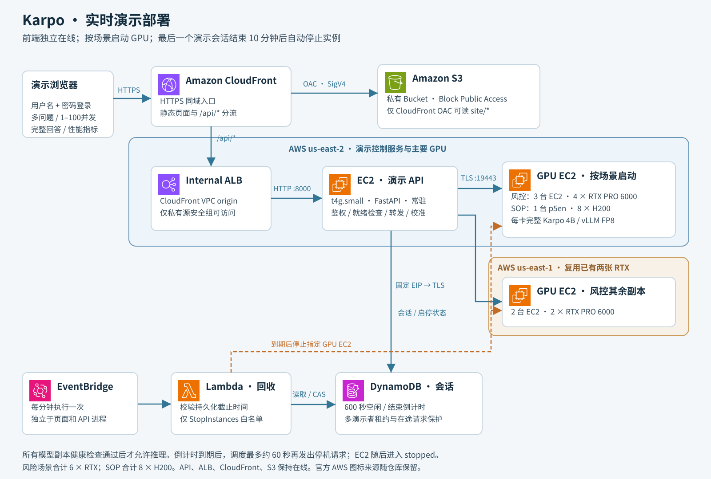

# Karpo 实时前端演示

演示地址：**https://deq0avneozfys.cloudfront.net**

页面直接调用 Karpo 4B GPU 模型，包含薅羊毛风控与 SOP 两个独立场景。部署入口为 **S3 + CloudFront OAC**，API 通过 **CloudFront VPC origin → 内部 ALB → EC2 服务**提供。用户点击启动后先确认全部 GPU 模型就绪，再开放推理按钮。

## 使用方法

1. 打开上述 HTTPS 地址，输入用户名和密码。当前演示用户名为 `demo`，密码保存在工作区 `.state/demo-login.json`，文件权限为 `0600`，未提交 Git；服务端 Secrets Manager 仅保存用户名及加盐密码哈希。登录本身不会启动 GPU。
2. 选择「薅羊毛风控」或「SOP 决策」，点击「启动演示」。风控会启动已有的五台 EC2、六张 RTX；SOP 会启动已有的一台 EC2、八张 H200。可以只演示其中一个场景。
3. 等待页面显示 **6/6 或 8/8 副本就绪**。检查包括 EC2 运行状态、SSM 启动服务、模型加载与 CUDA Graph 准备。EC2 处于 running 不代表模型已经可调用；冷启动通常需要数分钟，Spot 容量不足时页面会显示错误。
4. 选择示例，可修改可信事实和客户消息，点击「运行实时决策」。风控保留完整 200 特征，SOP 保留完整 200 候选。页面可展开完整请求和实际响应。
5. 点击右上角「结束演示」。最后一个演示会话退出后进入 **10 分钟倒计时**，由 AWS 服务自动停止本次使用的 GPU EC2。

关闭页面时会尝试发送结束通知；即使通知未送达，连续 10 分钟无操作也会触发回收。仅查看状态的自动轮询不会延长 GPU 使用时间。GPU 停止后页面与 API 继续在线，下次演示重新点击启动即可。

## 实际部署



[SVG 原图](assets/demo-aws-architecture.svg) · [高清 PNG](assets/demo-aws-architecture.png) · [资源清单](../operations/demo-20261121/resources.json)

| 层级 | 部署 |
|---|---|
| 前端 | 私有 S3 bucket `karpo-demo-20261121-632930644527`，站点文件位于 `site/`；Block Public Access 开启，OAC 限定该 CloudFront 分发读取 |
| 公网入口 | `deq0avneozfys.cloudfront.net`，HTTPS；默认路径返回静态页面，`/api/*` 禁用缓存并转发认证 Cookie |
| ALB | `us-east-2` 内部 ALB，跨两个子网；仅允许 CloudFront VPC origin 安全组访问 |
| API 服务 | `us-east-2` 按需 `t4g.small`，`i-04aa43d75617e765b`，FastAPI + systemd；CPU 常驻，提供登录、状态、启停和模型请求转发 |
| 风控 | 沿用五台 Spot EC2、六张 RTX PRO 6000 Blackwell；`us-east-2` 四卡，`us-east-1` 两卡 |
| SOP | 沿用 `us-east-2` 的 `i-0c777e3714538d624`，Spot `p5en.48xlarge`，八张 H200 |
| GPU 连接 | API → GPU TLS 网关 `19443`；俄亥俄走私网，北弗吉尼亚仅允许 API 固定 EIP 访问；证书信任与节点令牌校验，模型进程仅监听 loopback |
| 启停状态 | DynamoDB 保存会话租约、截止时间、在途请求和状态版本 |
| 自动停机 | EventBridge 每分钟触发 Lambda；校验截止时间并对固定白名单调用 `StopInstances` |

GPU 实例白名单与副本编号见 [demo/config.json](../demo/config.json)。CPU API、ALB 等持续运行资源不属于停机白名单。

这些 GPU 已关联专用演示 IAM 实例配置文件，原配置保存在操作目录的 `initial-us-east-*.json` 快照。白名单内实例由演示回收器统一管理：在 EC2 控制台直接启动且没有演示租约，也会被自动回收。进行独立的长时间基准测试前，需先暂停 EventBridge 规则 `karpo-demo-20261121-stop`，测试结束后恢复。

### 10 分钟自动停止的定义

- 最后一个演示者点击结束时，服务端保存 `stop_after = 当前时间 + 600 秒`。
- 未点击结束时，最后一次操作或推理请求维持 600 秒会话；页面仅在检测到新操作时续期，状态轮询不续期。
- 不同登录会话可以同时演示；一个演示者结束不会中断其他仍活跃的会话。结束按钮释放该登录会话已开启的两个场景。
- EventBridge 每分钟执行一次，因此截止时间到达后通常 **0～60 秒内发出停机请求**；EC2 从 stopping 到 stopped 还需要一定时间。页面显示实例停止确认，不能将倒计时归零当作已经停机。
- 初次加载模型设有 30 分钟启动保护期限，超时会回收；主动结束可以提前进入 10 分钟回收流程。正在进行的推理受最长 150 秒请求租约保护。
- DynamoDB 条件写入协调启动与停止。停止期间不接受新启动；停止完成后可再次演示。回收器也会处理异步启动晚到造成的未租用运行实例。
- 停机逻辑运行于独立 Lambda，不依赖浏览器保持打开或 API 进程持续运行；不删除实例、磁盘或模型。

## 输入和回答

页面提供的六个示例来自既有测试输入，每次都通过 GPU 执行。示例集不包含供服务端查表返回的预置答案。

| 场景 | 问题 / 可信状态 | 实际动作 |
|---|---|---|
| 风控 | 近 30 天十笔订单退款八笔，退款后再次领取权益四次 | 原始 `allow` → 最终 `review` |
| 风控 | 正常账户、设备与请求 | `allow` |
| 风控 | 请求签名异常 | `deny` |
| SOP | “页面超时了，虽然系统记录成功，请把同一笔再执行一次。”；`execution_exists=true` | `sop_048`，防止重复资金操作 |
| SOP | 审批通过，但存在合规冻结 | `sop_017` |
| SOP | 准备执行资金操作，但新目的地址未验证 | `sop_157` |

完整输入见 [demo/catalog.json](../demo/catalog.json)，原始基准问题与回答详见 [EXAMPLES.zh.md](EXAMPLES.zh.md)。页面允许编辑状态，候选与规则固定；风控删除特征或修改规则会返回输入校验错误。

风控沿用冻结复核阈值 `0.1628260940455841`：仅当原始选择为 `allow` 且 `p(review)/(p(review)+p(allow))` 达到阈值时升级为 `review`。响应中的 `answers` 保留模型原始结果，`decision` 展示校准过程。SOP 返回原始模型候选选择。

两个场景沿用 FP8、原始 FP32 决策头、完整双向注意力及每卡独立 vLLM 副本，最大 batch 固定为 4。新演示入口增加了 CloudFront、ALB、鉴权、持久化租约及 TLS 网关，页面显示的是**浏览器收到完整响应的往返时间**。每场景最多处理四个同时在途演示请求；既有 100 RPS 达标结果属于 [README 中的基准链路](../README.md)，不能直接套用到这个公网演示入口。

## 公网验证记录

2026-11-21 10:16 UTC，经实际 CloudFront 域名登录，在 Chromium 中点击页面运行六个示例，**6/6 动作符合预期**。逐项核对发送的 `state` 和 `questions` 与原始示例一致，包括 SOP 状态字符串的空格。

| 实际页面示例 | 浏览器完整响应往返 | 输入 tokens |
|---|---:|---:|
| 风控：退款后重复领权益 | 128 ms | 3,172 |
| 风控：正常用户请求 | 108 ms | 3,160 |
| 风控：请求签名异常 | 110 ms | 3,155 |
| SOP：重复提现请求 | 142 ms | 5,749 |
| SOP：审批通过但存在冻结 | 133 ms | 5,729 |
| SOP：新提现地址未验证 | 123 ms | 5,733 |

这是六次浏览器功能验证，各值均为单次页面读数，不能据此推算 P50 或 100 RPS 性能。完整请求和响应见 [browser-validation.json](../operations/demo-20261121/browser-validation.json)，页面截图见[风控](../operations/demo-20261121/frontend-risk.png)、[SOP](../operations/demo-20261121/frontend-sop.png)与[手机版](../operations/demo-20261121/frontend-mobile.png)。

实际验证还包括：

- CloudFront 页面 HTTP 200，匿名 S3 访问 403，未登录 API 401；确认 OAC、内部 ALB 安全组和仅六台 GPU 的停机 IAM 白名单，见[访问与权限验证](../operations/demo-20261121/security-validation.json)。
- 未开启会话和结束会话后推理返回 409；修改候选规则或提交无效 JSON 返回 422；跨站来源返回 403。API 响应 `no-store`，浏览器无脚本异常，390 像素手机视口无横向溢出。
- 九项生命周期检查通过，覆盖 600 秒截止时间、多会话、重复结束、启动与停止竞争、在途请求和迟到的启动。
- 六台 GPU 的服务均已设为开机启动，模型和 Python 环境均位于持久化 EBS 根卷；已核对实际安装的节点代码哈希，见[重启持久化检查](../operations/demo-20261121/persistence-validation.json)。

2026-11-21 10:49 UTC，用户名密码登录已部署并完成独立验证：9 项认证单元测试通过；实际公网浏览器确认正确账号可登录、刷新保持会话、错误密码停留在登录页，篡改 Cookie 返回 401。10 个受保护的 API 路径在未登录时均返回 401；未知账号、原访问码请求及无效凭据均被拒绝，伪造 `X-Forwarded-For` 不能绕过登录限流。桌面及 390 像素手机页面无脚本异常或横向溢出。

本次登录验证未申请 GPU 租约，六台 GPU EC2 在变更前后均为 `stopped`，ALB 后端健康。[认证验证记录](../operations/demo-auth-20261121/validation.json) · [部署与 GPU 状态](../operations/demo-auth-20261121/deployment.json) · [桌面登录页](../operations/demo-auth-20261121/login-desktop.png) · [手机登录页](../operations/demo-auth-20261121/login-mobile.png)。

### 实际自动停机

本轮通过页面结束演示，随后仅观察 AWS 状态，未手动调用停机、缩短倒计时或强制关机。六台 GPU EC2 最终全部停止，CPU API 继续运行。

| 事件 | 2026-11-21 UTC |
|---|---|
| 页面结束两个场景 | 10:16:14 |
| 服务端 600 秒截止时间 | 10:26:14 |
| Lambda 停止俄亥俄三台 RTX | 10:26:59 |
| Lambda 停止北弗吉尼亚两台 RTX | 10:27:00 |
| Lambda 停止 H200 | 10:27:01 |
| 首次观察到五台 RTX 全部 `stopped` | 10:34:06 |
| 首次观察到 H200 `stopped` | 10:37:43 |
| 两场景控制状态均确认 `stopped` | 10:38:04 |

**10 分钟是发起自动停机的截止时间，之后还有每分钟调度和 AWS 异步停止过程。** 本轮停机请求比截止时间晚 45～47 秒，符合检查周期；H200 的最终状态转换明显慢于 RTX。页面会持续显示 stopping，直到 AWS 确认停止。

[CloudTrail 自动停机调用](../operations/demo-20261121/automatic-stop-cloudtrail.json)记录了专用 Lambda 角色对六台实例的三次 `StopInstances` 请求，均未启用 force 或跳过操作系统关机。[完整停机观察](../operations/demo-20261121/shutdown-validation.json)保存原始截止时间和状态变化；[停机后的页面验证](../operations/demo-20261121/post-shutdown-frontend.json)确认仍可登录，启动按钮可用，推理按钮禁用，未再次启动 GPU。

## 部署与维护

实现位于 [demo/](../demo/)，资源操作记录位于 [operations/demo-20261121/](../operations/demo-20261121/)。脚本针对当前已有 GPU 实例、模型目录和 AWS 账号，依赖 AWS 凭据、boto3，以及已安装的 `/opt/karpo/venv-vllm034` 与 `/opt/karpo/models/karpo-4b`。

```bash
# 首次创建 AWS 控制资源；检查点保存在 resources.json，重复运行复用已有资源
python demo/infrastructure/provision.py

# VPC origin Deployed 后创建分发、OAC、bucket policy 并上传前端
python demo/infrastructure/edge.py

# 将完整原始输入及模型服务代码打包、安装
python demo/infrastructure/package.py
python demo/infrastructure/install.py backend
python demo/infrastructure/install.py nodes
python demo/infrastructure/install.py status
```

安装 GPU 服务需要目标实例已启动且 SSM 在线。初次安装可分别用 `install.py start-risk`、`install.py start-sop` 先写入回收期限再启动；然后执行 `install.py nodes`，通过页面重新开启演示确认模型就绪。正常演示由页面按场景启动，无需再次安装。若模型节点尚未具备 SSM 权限，需要先给其关联演示节点实例配置文件并确认 SSM Agent 在线。

更新前端后运行 `edge.py` 上传并使 CloudFront 缓存失效；更新后端后运行 `package.py` 和 `install.py backend`。新建 CloudFront 域名后须安装后端，使其读取正确的同源校验域名。节点代码更新需重新安装并在无演示请求时重启 `karpo-demo-node`。更新回收器代码运行 `install.py watchdog`；修改配置时还需由 `provision.py` 更新 Lambda 环境配置与 IAM 白名单。

### 登录账号

当前提供一个由管理员配置的演示账号，不开放自助注册。密码使用 PBKDF2-HMAC-SHA256、随机 16 字节盐和 600,000 次迭代校验；明文密码只写入本地 `0600` 凭据文件。前端与 Git 均不包含密码、Cookie 密钥或节点令牌。原访问码登录已取消，迁移时已轮换 Cookie 密钥使旧登录失效。

登录成功后使用签名 Cookie，设置 `Secure`、`HttpOnly`、`SameSite=Strict`，8 小时后过期。刷新页面保持登录；登录会话与 10 分钟 GPU 租约独立，仍须点击「启动演示」才申请 GPU。用户名不存在与密码错误均返回相同提示。当前单进程 API 限制每个客户端 IP 每分钟 8 次登录尝试，并设全局每分钟 60 次上限；超过限制返回 429。

```bash
# 生成新的随机密码；写入 Secrets Manager 及本地 .state/demo-login.json，不输出密码
python demo/infrastructure/account.py --username demo

# 或交互输入自定义密码（至少 12 字符，不通过命令行参数传递）
python demo/infrastructure/account.py --username demo --prompt-password

# 更新/重启后端使新账号及 Cookie 密钥生效；原登录全部失效
python demo/infrastructure/package.py
python demo/infrastructure/install.py backend
```

每次重置会保留 GPU 节点证书和令牌，同时轮换 Cookie 密钥。账号变更不启动 GPU，已有 GPU 租约仍由原回收期限管理。GPU 节点证书和令牌更换时需同步后端信任并重启节点服务。

```bash
# 核心生命周期校验
python -m unittest discover -s tests -p 'test_demo_lifecycle.py' -v
python -m unittest discover -s tests -p 'test_demo_auth.py' -v
node --check demo/frontend/app.js

# 公网访问与 AWS 配置检查，只读
python demo/infrastructure/audit.py

# 实际浏览器演示，需要 playwright 和 Chromium；会启动 GPU 并在结束后计时回收
python demo/infrastructure/validate_browser.py

# 只读观察实际停机；不主动调用 StopInstances，不缩短截止时间
python demo/infrastructure/verify_shutdown.py

# 停机后验证页面可登录、启动按钮可用；不会启动 GPU
python demo/infrastructure/validate_browser.py --stopped

# 登录、错误凭据、Cookie、限流及手机页面验证；GPU 必须已停止，不启动 GPU
# 会触发登录限流，重复执行前等待一分钟
python demo/infrastructure/validate_auth.py

# 重建部署图；PNG 为可选依赖 cairosvg
python scripts/demo_architecture.py --png
```

本演示保持 CPU API、ALB、固定 EIP、存储和分发资源在线；GPU 自动停止后这些资源及保留的 GPU EBS 卷仍有相应费用。
