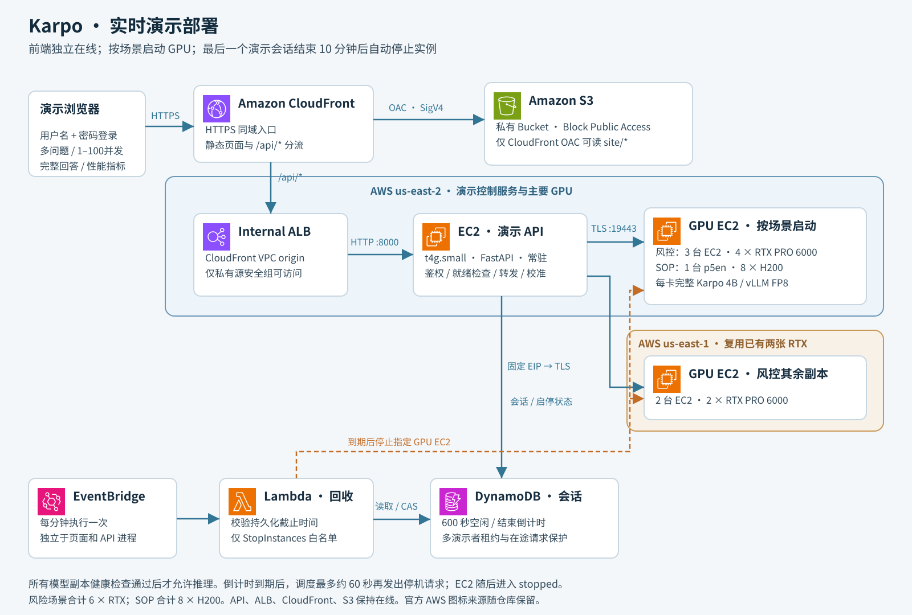

# 部署方案、原生对照与优化收益

截至2026-11-21，风控与SOP均使用 **Karpo 4B + vLLM 0.34.0 + FP8 + CUDA Graph**，每张GPU运行一个完整模型副本，当前最大batch固定为4。风控使用六张RTX PRO 6000 Blackwell，SOP使用八张H200，两类GPU分别服务各自场景。

同一张RTX、相同输入的单请求对照中，vLLM方案使旧风控输入的HTTP P50降低 **47.89%**，SOP降低 **31.40%**。当前六RTX云端风控已连续两轮满足100 RPS、P50≤500ms；SOP八H200原基准达标，增加公网演示入口后的稳定性尚未完成验收。下面分别列出推理方案、硬件扩容和演示服务优化的证据。

## 当前部署要点

| 层级 | 实现 | 作用 |
|---|---|---|
| 前端与入口 | 私有S3 + CloudFront OAC；API通过CloudFront VPC origin进入内部ALB | 提供HTTPS页面与认证后的API访问 |
| CPU服务 | `us-east-2` 的一台 `t4g.small`，运行FastAPI及独立云端压测进程 | 提供登录、输入校验、GPU就绪检查、请求转发和测试管理 |
| 风控推理 | 五台Spot EC2、六张RTX PRO 6000 Blackwell Server Edition 96GB；俄亥俄四卡、北弗吉尼亚两卡 | 每卡独立处理请求，分担持续100 RPS负载 |
| SOP推理 | 俄亥俄一台Spot `p5en.48xlarge`、八张H200 | 为完整200候选的较长输入提供独立副本池 |
| GPU访问与调度 | API到GPU网关使用TLS，模型端口仅监听loopback；优先选择在途请求最少的副本，同负载轮转 | 复用连接、均衡负载并限制排队规模 |
| 测试与历史 | AWS进程按固定RPS调用公网CloudFront；DynamoDB保存任务与索引，私有S3保存完整输入输出 | 浏览器刷新或断网后可继续查看同一任务，全部历史可追溯 |
| GPU生命周期 | 启动后检查全部模型副本；演示结束或闲置10分钟后，由EventBridge + Lambda触发停止 | 页面与CPU服务持续可用，GPU按演示需要运行 |

风控六卡之间以及SOP八卡之间采用独立副本方式，`tensor_parallel_size=1`。每个请求只使用一张GPU；增加副本主要提升可承接的请求量、减少排队。`max_num_seqs=4`限制每卡最多同时调度四条序列，无需等到凑满四条才执行。CPU API每场景最多接收100条在途请求，每GPU转发槽位上限16，超额或超时请求明确返回错误。

单次问题路径为“浏览器 → CloudFront → ALB → API → GPU → 返回”；多场景测试路径为“AWS压测进程 → CloudFront → ALB → API → GPU → 返回”。浏览器在多场景测试中只提交任务和查看结果。两者均发送完整输入，风控保留200特征，SOP保留200候选。

GPU型号、区域及进程位置见[风控原基准架构](ARCHITECTURE.zh.md)、[SOP基准部署](../experiments/vllm-sop-h200-20261120/REPRODUCE.zh.md)；当前公网网络、认证和启停细节见[演示部署说明](DEMO.zh.md#实际部署)。

## 相对原生部署做了哪些优化

“原生对照”指2026-11-20在同一张RTX上运行的Karpo原生FP8服务，使用原始Decider、自建HTTP服务及进程队列。**该对照已经启用FP8、编译和CUDA Graph**；不能把这些能力全部算作迁移vLLM后新增的收益。

| 方面 | 原生对照 | 当前方案及目的 |
|---|---|---|
| 推理引擎 | 原生Karpo/PyTorch执行与自建任务队列 | 使用vLLM异步引擎和调度器，整合请求调度与GPU执行 |
| 输入编码 | GPU工作进程依次规划输入并执行模型 | 在独立CPU线程编码，用锁保证编码器安全，与独立GPU引擎执行重叠 |
| 量化实现 | Karpo原生FP8实现 | vLLM逐通道FP8权重与逐token动态激活；小型门控层和决策头保留所需精度 |
| CUDA Graph | 原生图捕获与回放 | 按完整输入长度配置vLLM prefill图；风控采用`powers`捕获策略，减少重复执行时的启动开销 |
| 多卡扩展 | 单卡作为引擎对照 | 风控六副本、SOP八副本；应用代理按在途数量分流 |
| 请求链路 | 基准客户端直接访问本机服务 | 演示API使用异步连接池、受限在途数量和持久化会话，承接公网及测试请求 |

Karpo通过专用vLLM适配器加载原始模型权重和readout，保留原始模板、marker后的token、双向全注意力及原有因果GatedDeltaNet；在Karpo marker位置用原始FP32决策头读取结果。前缀缓存与chunked prefill关闭，以保持完整输入的决策语义。没有截断候选、精简特征或缓存答案来换取这些测试结果。

单卡对照的原生Torch版本为`2.14.1+cu130`，vLLM使用`2.14.0+cu130`。实测反映两套完整服务方案，包含调度、编码流水线、量化与计算实现差异；尚未逐项做消融实验，无法给每项优化分配独立的加速百分比。

实现依据：[vLLM模型适配](../serving/vllm_karpo/karpo_vllm_model.py)、[当前风控模型服务](../scripts/promo_opt_server.py)、[GPU网关启动配置](../demo/backend/node.py)、[副本路由](../demo/backend/routing.py)、[原生服务](../scripts/batch100_server.py)。

## 同卡实测：提升了多少

### 单请求延迟

同一台`g7e.4xlarge`、同一张RTX PRO 6000 Blackwell 96GB，两套FP8服务顺序运行，保留相同原始输入。下表对应`native-initial`和`vllm-b4`的`serial`阶段：HTTP在途数量为1，原生batch=1，vLLM最大序列数=4。计时包含本机HTTP、编码、排队和模型响应，不含公网入口。

| 场景 | 原生HTTP P50 | vLLM HTTP P50 | 延迟降低 | 原生耗时 / vLLM耗时 |
|---|---:|---:|---:|---:|
| 旧版服务资源风控输入 | 85.91ms | 44.76ms | **47.89%** | 1.92× |
| SOP完整输入 | 162.82ms | 111.69ms | **31.40%** | 1.46× |

这里的风控是当时的服务资源风控输入，不能把44.76ms直接当作后来扩充薅羊毛行为输入后的延迟承诺。

### 单卡持续压力下的独立复测

该早期实验始终维持 **100条在途HTTP请求，持续60秒后排空**。它测量饱和压力下的响应时间和吞吐，发送速率由请求完成速度决定。独立复测比较原生batch=1与当时选出的vLLM最大序列数=8，包含批处理配置差异；当前部署仍固定为4。

| 场景 | 原生P50 → vLLM P50 | P50降低 | 原生吞吐 → vLLM吞吐 | 吞吐提升 |
|---|---|---:|---|---:|
| 旧版服务资源风控输入 | 4233.94 → 3382.01ms | 20.12% | 23.60 → 28.54 RPS | **20.91%** |
| SOP完整输入 | 11983.30 → 9234.93ms | 22.93% | 8.33 → 10.38 RPS | **24.69%** |

这一单卡结果说明vLLM方案提高了处理能力，但仍不足以在100条持续在途请求下达到500ms目标。后续100 RPS正式验收采用固定到达率和多个GPU副本，测量方式不同。

延迟降低按`1－vLLM耗时/原生耗时`计算，吞吐提升按`vLLM RPS/原生RPS－1`计算，百分比使用未四舍五入的原始数值。

证据：[单卡完整报告](../experiments/vllm-single-20261120/RESULTS.zh.md)、[固定条件及验证计划](../experiments/vllm-single-20261120/PLAN.zh.md)、[原生初测](../experiments/vllm-single-20261120/results/measurements/native-initial/)、[vLLM最大序列数4](../experiments/vllm-single-20261120/results/measurements/vllm-b4/)、[原生独立复测](../experiments/vllm-single-20261120/results/measurements/native-confirm/)、[vLLM独立复测](../experiments/vllm-single-20261120/results/measurements/vllm-confirm/)。

## 多卡部署达到的能力

下列均采用固定到达 **100 RPS × 120秒**，每轮12,000次请求；各行按时间顺序列出两轮P50。每轮单独判定，不能把这些数值与前述单卡100条在途实验计算加速倍数。

| 部署与输入 | 两轮端到端P50 | 两轮失败数 | 两轮全量正确率 | 已验证范围 |
|---|---|---|---|---|
| 六RTX原基准，完整薅羊毛输入 | 67.62 / 68.11ms | 0 / 0 | 98.90% / 98.90% | 包含应用代理、校准及跨区域通信，未包含公网演示入口 |
| 六RTX当前云端演示测试，同一压力问题集 | 72.25 / 318.91ms | 0 / 0 | 98.90% / 98.69% | 包含公网CloudFront、ALB、API、GPU及排队 |
| 八H200原SOP基准，完整200候选 | 76.58 / 76.24ms | 0 / 0 | 94.25% / 94.25% | 压测、代理及GPU在同一主机，未包含公网演示入口 |

六RTX和八H200均是已经验证的达标配置，尚未证明是各场景绝对最低配置。六RTX原基准已经使用vLLM，当前演示沿用同一模型引擎；增加公网入口后，没有证据证明整体延迟比原基准更低。

当前风控第二轮的`engine_wait_and_model_ms` P50为294.73ms，第一轮为55.15ms。此字段合并引擎等待、模型执行与结果处理；第二轮增长的主要位置已找到，但触发原因尚未完全定位，不能把72.25ms当作稳定承诺。

SOP公网演示此前第一轮P50为107ms，第二轮P50为928ms并出现2,602次429。当前新的云端执行方案尚未完成SOP单独验收，八H200原基准达标不等于公网演示已稳定达标。

来源：[六RTX正式结果](../experiments/promo-rtx6-20261121/RESULTS.zh.md)、[八H200正式结果](../experiments/vllm-sop-h200-20261120/RESULTS.zh.md)、[云端演示逐轮证据](../operations/demo-cloud-20261121/README.zh.md)、[公网SOP结果](DEMO.zh.md#2026-11-21-公网固定rps实测)。

## 演示链路的积压优化

这一阶段复用原CPU EC2和六RTX，模型、输入、FP8和最大batch=4保持一致。主要调整包括：

1. 将多场景请求生成放在AWS独立进程，按固定计划发起完整请求；浏览器的上传带宽、断网和刷新不再承担或中断逐条发送。
2. API启用uvloop、httptools，API转发和云端压测使用aiohttp连接池；配置完整请求超时，POST不自动重试。API keep-alive设为210秒，与ALB的180秒空闲超时协调；到GPU网关的连接空闲复用期限设为2秒。
3. 将会话续期合并为约每5秒一次DynamoDB操作，复用AWS SDK客户端；同负载副本采用轮转，避免请求集中到靠前GPU。
4. 将统计移到后台线程，及时释放已完成任务；任务、进度和完整响应持久化，支持断网恢复与提前停止。

同在AWS执行、经过公网入口的初版与最终两轮结果如下：

| 指标 | 云端初版 | 最终第1轮 | 最终第2轮 |
|---|---:|---:|---:|
| 成功 / 计划 | 11,971 / 12,000 | 12,000 / 12,000 | 12,000 / 12,000 |
| 稳态有效吞吐 | 91.93 RPS | 99.91 RPS | 99.67 RPS |
| 端到端P50 | 278.50ms | 72.25ms | 318.91ms |
| 端到端P95 | 7315.82ms | 109.87ms | 415.41ms |
| 最大发送滞后 | 10592.73ms | 63.29ms | 64.24ms |
| 稳态在途数量增长斜率 | 1.2224请求/秒 | 0.0215请求/秒 | 0.0456请求/秒 |

相比云端初版，最终两轮的稳态有效吞吐分别提高 **8.68% / 8.41%**，P95分别降低 **98.50% / 94.32%**，最大发送滞后分别降低 **99.40% / 99.39%**，失败请求从每轮29次降为零。这些是CPU与服务链路累计优化后的观测结果。

这组结果支持“请求发送和服务链路的积压显著改善，最终两轮通过验收”。整体P50存在波动，第二轮P50高于初版，所以不将这组优化表述为所有延迟指标都稳定下降。各项代码调整没有单独消融，表中体现累计修改后的效果。

原用户浏览器测试的P50为8105ms，后来改变了请求生成位置，因此不使用它与云端72.25ms的比值计算模型加速。仅把单次页面改成显示后端计时，也不会改变模型执行速度。

全部中间失败、预热、最终正式轮次与浏览器断网验证见[积压修复记录](../operations/demo-cloud-20261121/README.zh.md)。

## 决策质量与计时范围

薅羊毛风控还有一项决策校准：原始动作是`allow`，且`p(review)/(p(review)+p(allow)) ≥ 0.1628260940455841`时，最终动作升级为`review`。同一1080条合成质量集上，原始模型选择正确率为78.06%，最终决策为98.43%，提升 **20.37个百分点**。这是业务决策校准的效果，不能计作vLLM加速或模型训练收益。原始回答和最终动作分别保存在`answers`与`decision`。

| 指标 | 起止点 | 主要覆盖范围 |
|---|---|---|
| 单次问题的后端服务端到端延迟 | API推理处理开始至最终决策就绪，即`demo.service_ms` | 服务端排队、GPU往返、推理与复核；鉴权和输入校验之前的阶段、最终序列化及浏览器传输不在其中 |
| 多场景测试的云端端到端延迟 | AWS进程计划发送至完整响应解析完成 | 发送滞后、CloudFront、ALB、API、GPU及链路中的排队；不含用户浏览器网络 |
| 模型阶段耗时 | 输入编码完成后至模型结果处理完成 | 引擎等待和执行合计，不能直接视为纯GPU计算时间 |

正确率来自既有合成问题集，仍需用生产分布下的标注数据验证。本次文档整理依据已有实测与已部署代码，没有重新运行GPU测试或调整batch。
