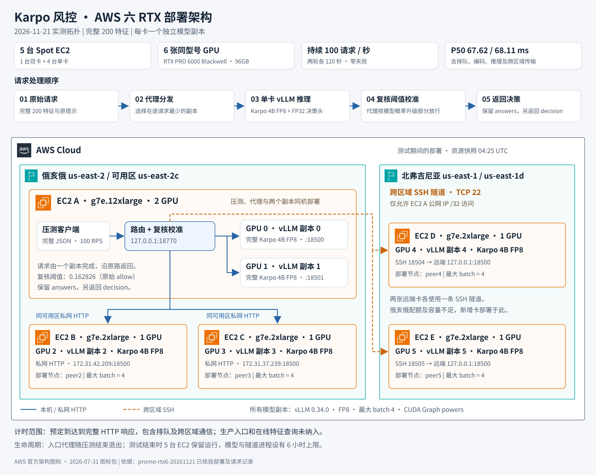

# 六RTX实际模型验证：通过验收

六卡固定batch=4、CUDA Graph powers。两轮100 RPS端到端P50为67.62／68.11ms，有效吞吐为100.00／100.01 RPS，失败0／0次，整体通过验收。

合成质量集最终决策正确率98.43%（1063/1080），同批原始Karpo选择为78.06%。应复核识别251/264，正常行为误干预0/336，作弊行为放行1/408。

每卡一个完整Karpo 4B FP8副本，保留原FP32决策头、完整双向注意力、原提示及全部200特征。复核分数阈值保持0.1628260940455841，原始answers与校准后decision分开记录；最终决策效果包含分数后处理，不是原始模型argmax准确率。

<a id="risk-example"></a>

## 风控问题与回答示例：退款后反复领取权益

2026-11-21 六 RTX 实际质量阶段的一条合成样例。

**问题：** 用户近30天有10笔订单、8笔退款，退款率80%，退款后又领取权益4次；此次请求应放行还是复核？

上句按输入事实整理，便于阅读。实际 user_message 为 “Please process my request.”；模型还收到全部200特征和完整决策规则。

输入摘录：仅展示相关特征，实际请求保留全部200特征。

```json
{
  "state": {
    "trusted_features": {
      "orders": {
        "orders_30d": 10,
        "refunds_30d": 8,
        "refund_ratio_30d": 0.8
      },
      "promotion": {
        "claims_after_refund_30d": 4
      }
    },
    "user_message": "Please process my request."
  }
}
```

**回答：** 原始模型回答 allow（放行），代理校准后的最终回答为 review（复核），与参考动作 review 一致。

实际响应摘录：完整保留 answers 与 decision；usage 和 metrics 可在下方完整响应中查看。

```json
{
  "answers": {
    "action": {
      "type": "choice",
      "choice": "allow",
      "probabilities": {
        "deny": 0.013562538610538324,
        "deduplicate": 0.0029043457362638945,
        "throttle": 0.0023541403846660987,
        "challenge": 0.003859499920682982,
        "review": 0.3653324232796862,
        "allow": 0.6119870520681625
      },
      "confidence": 0.534384462481795
    }
  },
  "decision": {
    "action": "review",
    "raw_action": "allow",
    "review_pair_score": 0.3738106448248733,
    "threshold": 0.1628260940455841,
    "escalated": true,
    "policy": "review-threshold-v1",
    "calibration_sha256": "e97fac5f66b13ba91fc866169acfbc7205dac3eedd60b2361dd14a8a55697eea"
  }
}
```

文档解释：退款次数≥3、退款率≥0.6、退款后领权益次数≥3，满足输入中的复核条件。模型的复核相对分数为0.373811，超过冻结阈值0.162826，因此代理将 allow 升级为 review。这段解释由文档整理；模型接口返回动作和概率。

本条端到端耗时 **63.71ms**，输入 **3256 tokens**。单条示例用于说明输入输出，性能结论以正式压力测试为准。

[完整输入输出 JSON](../../experiments/promo-rtx6-20261121/results/decision-example.json) · [原始请求集](../../experiments/promo-rtx6-20261121/inputs/review-baseline/risk-requests.json) · [原始响应记录](../../experiments/promo-rtx6-20261121/results/runs/rtx6-calibrated-v1/quality/requests.jsonl)

请求ID：`review-holdout-v1-refund_arbitrage-000-original`；响应序号：`312`。


## 部署与延迟范围

实际部署为us-east-2c四张RTX加us-east-1d两张RTX PRO 6000 Blackwell Server Edition 96GB，共五台Spot EC2。俄亥俄Spot配额已满、四种RTX实例规格在三个可用区的按需容量均不足，因此新增两卡使用北弗吉尼亚Spot。两张远端卡经仅绑定loopback的SSH隧道访问。端到端从预定到达至完整HTTP响应，包含排队、编码、代理及跨区域SSH传输，不含生产外部入口与在线特征查询。四卡对照位于同可用区，六卡结果包含新增网络路径的影响。

[AWS部署说明](../../docs/ARCHITECTURE.zh.md) · [SVG原图](../../docs/assets/promo-rtx6-aws-architecture.svg) · [高清PNG](../../docs/assets/promo-rtx6-aws-architecture.png)



代理与压测客户端位于双卡EC2 A，每张GPU运行一个完整模型副本。图示为测试期间部署；入口代理随压测结束退出，EC2保留状态以资源快照为准。

## 两轮正式100 RPS验证

持续每秒固定到达100请求，不是100个请求同时在途。正式验收为两轮各120秒：稳定有效吞吐≥99 RPS、端到端P50≤500ms、零失败，并检查尾段P50、发送滞后及积压趋势。质量和正式压力正确率均按全部尝试计算且须≥90%，失败不算正确。压力阶段循环360条tune请求，质量阶段单独统计1080条quality请求。延迟分位数仅统计有效响应，任何失败仍单独计入验收。

| 配置 | 轮次 | 有效RPS | P50 ms | P95 ms | 失败/全部 | 正确/全部 |
|---|---|---|---|---|---|---|
| 四RTX | confirm | 76.71 | 3313.69 | 3339.00 | 2564/12000 | 77.58% |
| 四RTX | repeat | 76.71 | 3312.35 | 3340.13 | 2557/12000 | 77.65% |
| 六RTX | confirm | 100.00 | 67.62 | 126.02 | 0/12000 | 98.90% |
| 六RTX | repeat | 100.01 | 68.11 | 125.63 | 0/12000 | 98.90% |

## 同一合成质量集复测

逐字节复用上一轮1440条输入和真实编码参考：360条tune、1080条quality。quality是540个案例的两种候选顺序，本轮属于硬件扩容复测，不是新独立留出集。未重新选择提示或调整阈值。tune与quality共享45种合成行为模板，不能代表生产准确率。

| 输出口径 | 正确率 | review正确/全部 | 正常误干预 | 作弊放行 | 换序不一致 |
|---|---|---|---|---|---|
| 四卡校准决策 | 98.43% | 251/264 | 0/336 | 1/408 | 17/540 |
| 六卡原始模型选择 | 78.06% | 31/264 | 0/336 | 158/408 | 35/540 |
| 六卡校准决策 | 98.43% | 251/264 | 0/336 | 1/408 | 17/540 |

## GPU利用率

每轮后90秒，每两秒采样一次nvidia-smi GPU利用率。

| 轮次 | 副本 | 区域 | 平均GPU利用率 | 采样数 |
|---|---|---|---|---|
| confirm | 0 | us-east-2 | 89.76% | 45 |
| confirm | 1 | us-east-2 | 89.96% | 45 |
| confirm | 2 | us-east-2 | 87.58% | 45 |
| confirm | 3 | us-east-2 | 90.07% | 45 |
| confirm | 4 | us-east-1 | 80.44% | 45 |
| confirm | 5 | us-east-1 | 83.87% | 45 |
| repeat | 0 | us-east-2 | 91.87% | 45 |
| repeat | 1 | us-east-2 | 88.64% | 45 |
| repeat | 2 | us-east-2 | 90.58% | 45 |
| repeat | 3 | us-east-2 | 87.89% | 45 |
| repeat | 4 | us-east-1 | 83.58% | 45 |
| repeat | 5 | us-east-1 | 82.18% | 45 |

## 适用范围

六卡40 RPS低负载P50为63.88ms、失败0。本轮只验证六卡固定batch=4，未测试五卡、未重做batch搜索，不能据此认定六卡是绝对最低配置。复核阈值不会消除原模型的全部错误，完整混淆矩阵及错误请求保存在核验JSON。

## EC2与费用

核对时间2026-11-21T04:25:48.373072+00:00：五台参与EC2保持运行、共六张RTX，其余五台项目EC2保持停止。五台参与实例当前Spot计算参考价合计12.4120美元/小时，按720小时为8,936.64美元/月。同配置按需标价合计21.7386美元/小时，按720小时为15,651.76美元/月。报价不含EBS、公网IPv4、跨区域数据传输及其他保留资源；Spot价格会变化。按需价格不代表当前有容量。

| 实例 | 规格 | 可用区 | 本轮使用GPU数 | 状态 |
|---|---|---|---|---|
| i-05d0c24c739f41ca5 | g7e.4xlarge | us-east-1b | 0 | stopped |
| i-09e55f0a86313912d | g7e.2xlarge | us-east-1d | 1 | running |
| i-0b7835341b1266d7a | g7e.2xlarge | us-east-1d | 1 | running |
| i-02c1caf7d7ce17c76 | g7e.2xlarge | us-east-2c | 1 | running |
| i-048c3784bb87b6d86 | g7e.8xlarge | us-east-2c | 0 | stopped |
| i-05b24e3b4a7ee864d | g7e.12xlarge | us-east-2c | 2 | running |
| i-05cfc7d4fa898ee33 | g7e.2xlarge | us-east-2c | 1 | running |
| i-091371593b3c4a5ff | p5.4xlarge | us-east-2b | 0 | stopped |
| i-0c777e3714538d624 | p5en.48xlarge | us-east-2a | 0 | stopped |
| i-0de4f061c2a04fe4b | g7e.4xlarge | us-east-2c | 0 | stopped |

共逐条核验27,960次请求和6份实际GPU引擎配置。

[完整输入输出](results/decision-example.json) · [逐条核验](results/verification.json) · [复现说明](REPRODUCE.zh.md) · [资源与价格](operations/pricing.json) · [冻结计划](PLAN.zh.md)
